# Microservices

## Motivation

When an information system grows in size and complexity, managing it as a single monolithic unit becomes increasingly difficult. A monolithic system is implemented, deployed, and maintained as one large application where all components are tightly interconnected. While this approach may be suitable for smaller projects, it introduces significant challenges as the system evolves.

One of the main disadvantages of a monolithic architecture is reduced maintainability. Since individual functionalities are strongly coupled, even a small modification in one part of the system may affect other components. Developers must understand a large portion of the application before making changes, which increases development time and the risk of introducing defects.

Another issue is limited scalability. If only a single subsystem experiences increased load, the entire application must typically be scaled, even though most components may not require additional resources. This often leads to inefficient use of computing infrastructure and higher operational costs.

Large monolithic systems also complicate team collaboration. Multiple development teams working on the same codebase can create conflicts, dependencies, and coordination challenges. As the system grows, development velocity often decreases because teams become less autonomous and changes require extensive integration testing.

Deployment and release management represent another significant challenge. In many monolithic systems, updating a single feature requires building, testing, and deploying the entire application. As a result, introducing a new version may require shutting down the whole system, causing service interruptions and reducing system availability. This risk becomes particularly problematic for organizations that require continuous operation, such as e-commerce platforms, banking systems, or healthcare applications.

Furthermore, fault isolation is difficult in a monolithic environment. A failure in one component can potentially affect the stability of the entire system. Instead of containing the problem within a limited area, a software defect may lead to partial or complete system downtime.

Technology evolution is another concern. Since all components belong to a single application, introducing new technologies, frameworks, or architectural patterns becomes challenging. The organization may become dependent on outdated technologies because replacing them requires extensive changes across the entire system.

To address these limitations, modern information systems are often divided into smaller, loosely coupled modules or services. Such an approach improves maintainability, enables independent deployment and scaling, supports parallel team development, and reduces the impact of failures. Consequently, modular and service-oriented architectures have become a common strategy for managing large-scale information systems.

## Microservice

As information systems grow in size and complexity, dividing the application into smaller, independent units becomes an effective way to improve maintainability and scalability. One of the most widely used architectural approaches for this purpose is the **microservices architecture**.

A **microservice** is a small, autonomous software component that implements a specific business capability and can be developed, deployed, and maintained independently of other components. Instead of building a single large application, the system is composed of multiple services that communicate through well-defined interfaces, typically using REST APIs, gRPC, or message queues.

For example, an e-commerce information system may be divided into several microservices:

* **User Service** - manages user accounts and authentication.
* **Product Service** - manages product catalogs.
* **Order Service** - processes customer orders.
* **Payment Service** - handles payments and transactions.
* **Notification Service** - sends emails and SMS messages.

Each service focuses on a single business domain and can have its own database, technology stack, and development lifecycle.

### **Advantages of Microservices**

The primary advantage of microservices is **modularity**. Since services are developed independently, changes made to one service usually do not require modifications to the rest of the system. This significantly improves maintainability and reduces the risk associated with software updates.

Another important benefit is **independent deployment**. A new version of a single microservice can be deployed without redeploying the entire system. Unlike monolithic applications, organizations often do not need to shut down the complete information system when releasing a new feature or bug fix. As a result, system availability is increased and downtime is minimized.

Microservices also provide **better scalability**. Only the services experiencing high demand need additional resources. For example, during a marketing campaign, the Product Service may require more computing power, while other services continue operating with existing resources. This leads to more efficient resource utilization and lower infrastructure costs.

From an organizational perspective, microservices support **parallel development**. Different teams can work on individual services independently, reducing coordination overhead and accelerating software delivery. Teams become more autonomous because they own specific services rather than sharing responsibility for a large common codebase.

Another benefit is **fault isolation**. If one microservice fails, the remaining services can often continue operating. For instance, if the Notification Service becomes unavailable, customers may still browse products and place orders. The impact of failures is therefore limited to a smaller part of the system.

Microservices additionally enable **technological flexibility**. Different services may use different programming languages, databases, or frameworks if required by their specific business needs. An organization can gradually adopt new technologies without redesigning the entire system.

**Challenges of Microservices**

Despite their advantages, microservices are not a universal solution. They introduce additional complexity related to service communication, distributed transactions, monitoring, security, and deployment orchestration. Organizations often rely on technologies such as **Docker**, **Kubernetes**, **API Gateways**, and **Service Discovery** mechanisms to manage large collections of microservices efficiently.

Consequently, microservices are particularly suitable for large-scale information systems where independent development, scalability, and frequent deployments are important requirements. For smaller systems, a monolithic architecture may still be a simpler and more cost-effective solution.

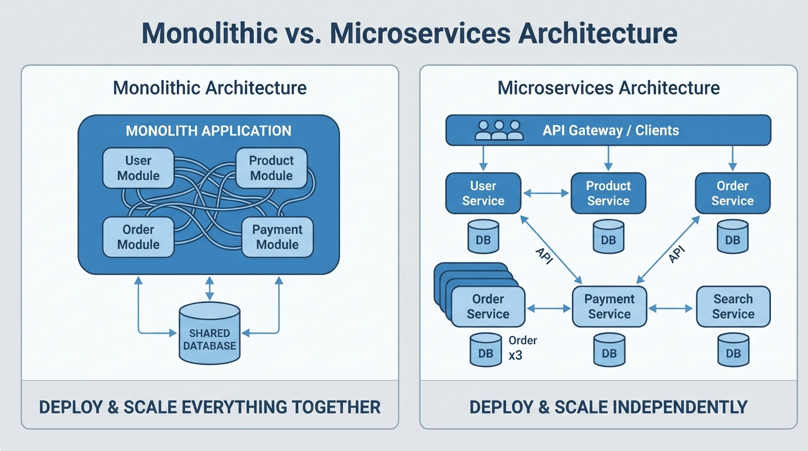

**Comparison: Monolith vs. Microservices**

| Aspect                 | Monolithic Architecture          | Microservices Architecture             |
| ---------------------- | -------------------------------- | -------------------------------------- |
| Deployment             | Entire application               | Individual services                    |
| Scalability            | Whole system                     | Selected services                      |
| Maintenance            | More difficult as system grows   | Easier due to modularity               |
| Fault Isolation        | Failure may affect entire system | Failure usually limited to one service |
| Team Independence      | Lower                            | Higher                                 |
| Technology Flexibility | Limited                          | High                                   |
| Release Downtime       | Often required                   | Usually minimal or none                |

In practice, microservices represent an architectural evolution that addresses many of the limitations of large monolithic systems. By decomposing an information system into smaller, independently deployable services, organizations can achieve greater agility, scalability, and maintainability while supporting continuous system evolution.

## Key Characteristics of Microservices

A microservice architecture is based on a set of design principles that distinguish it from traditional monolithic applications. These characteristics aim to improve maintainability, scalability, resilience, and development agility. Each microservice should be designed as an independent, self-contained software component responsible for a specific business capability.

### Atomicity

A microservice should be **atomic**, meaning that it focuses on a single business responsibility and performs one well-defined function within the system.

For example, in an e-commerce platform:

* Product Service manages products.
* Order Service manages orders.
* Payment Service processes payments.

A microservice should not combine unrelated responsibilities such as product management and payment processing within the same service.

#### Why It Is Important

Atomicity leads to:

* Clear service boundaries
* Easier maintenance
* Better reusability
* Reduced complexity
* Independent evolution of business functions

This principle is often summarized by the idea:

> "One service, one business capability."

***

### Simplicity

Each microservice should remain as simple as possible in terms of functionality, implementation, and dependencies.

Microservices are not intended to become miniature monoliths. As a service grows, its complexity should remain manageable and aligned with its business responsibility.

#### Why It Is Important

Simple services are:

* Easier to understand
* Faster to develop
* Easier to test
* Less error-prone
* Easier to replace or refactor

A small and focused service can often be maintained by a single development team with minimal coordination.

***

### Replaceability

A microservice should be **replaceable**, meaning that its implementation can be modified, upgraded, or completely rewritten without affecting the rest of the system, as long as its public interface remains unchanged.

For example:

```
Payment Service v1
```

may later be replaced by

```
Payment Service v2
```

while all consuming services continue to operate through the same API.

#### Why It Is Important

Replaceability enables:

* Technological evolution
* Easier modernization
* Reduced vendor lock-in
* Incremental system improvements

Organizations can continuously improve individual components without redesigning the entire system.

***

### Shared-Nothing Architecture

Microservices should follow the **Shared-Nothing Architecture** principle, meaning that services do not share internal state, memory, files, or databases directly.

Each service owns its resources.

Instead of:

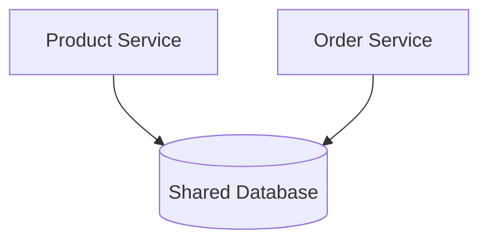

the preferred approach is:

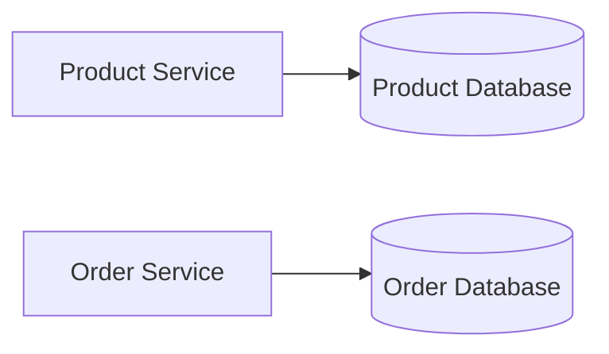

Communication occurs through APIs or messaging systems rather than direct data sharing.

#### Why It Is Important

Shared-Nothing Architecture provides:

* Loose coupling
* Better fault isolation
* Independent scaling
* Greater service autonomy
* Reduced risk of unintended side effects

A failure or schema change in one service does not directly impact others.

***

### Communication via Well-Defined Interfaces

Microservices interact exclusively through clearly defined interfaces, typically implemented using:

* REST APIs
* GraphQL
* gRPC
* Message brokers (Kafka, RabbitMQ, ActiveMQ)

The internal implementation details of a service are hidden from consumers.

Example REST endpoint:

```
GET /products/123
```

The caller does not need to know how product information is stored or processed internally.

#### Why It Is Important

Well-defined interfaces ensure:

* Loose coupling
* Interoperability
* Technology independence
* Easier testing
* Stable communication contracts

This principle allows services to evolve internally without breaking existing consumers.

***

### Deployed as Separate Runtime Processes

Each microservice should execute as an independent runtime process.

Rather than running all functionality inside a single application process:

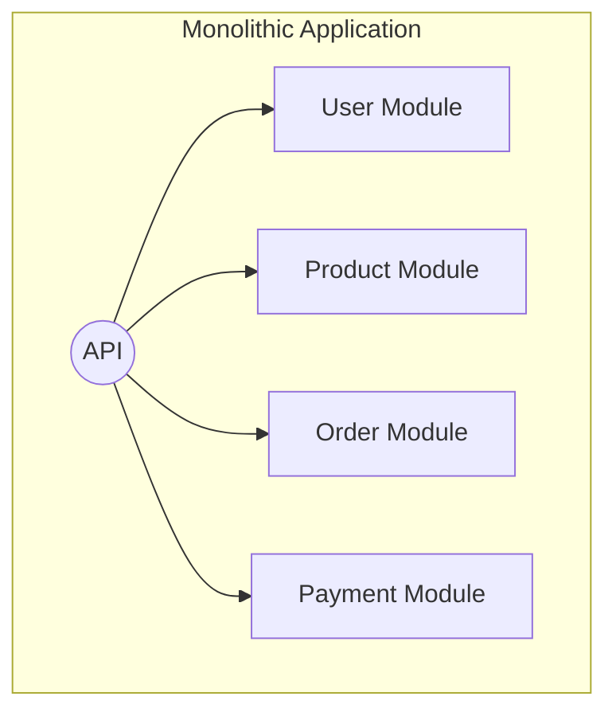

microservices operate independently:


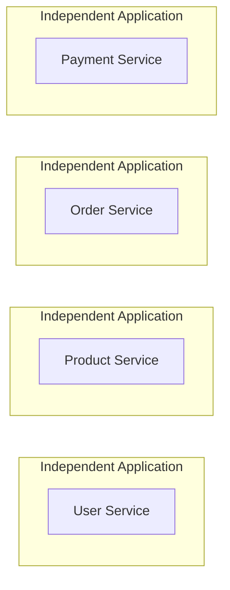

Each service is typically deployed as its own container.

#### Why It Is Important

Independent deployment enables:

* Separate release cycles
* Independent scaling
* Better fault isolation
* Technology flexibility
* Faster software delivery

For example, a new version of the Payment Service can be deployed without restarting the Product Service or Order Service.

***

### Statelessness

Microservices should ideally be **stateless**, meaning that they do not store session information or conversational state in their local memory between requests.

Every request should contain all information required for processing.

Example:

```
GET /orders/1001Authorization: Bearer <token>
```


The service processes the request independently without requiring information stored from previous interactions.

If state must be preserved, it should be stored in external systems such as:

* Databases
* Distributed caches (Redis)
* Object storage
* Message queues

#### Why It Is Important

Stateless services offer:

* Easy horizontal scaling
* Better load balancing
* Simpler failover mechanisms
* Improved reliability
* Easier container replacement

Because no session state is stored locally, requests can be routed to any available service instance.

***

### Autonomy

Another important characteristic of microservices is **autonomy**. Each service should operate independently from other services whenever possible.

Autonomous services manage:

* Their own codebase
* Their own deployment
* Their own database
* Their own lifecycle

#### Why It Is Important

Autonomy reduces dependencies between teams and allows faster development and deployment cycles.

***

### Scalability

Microservices are designed to support **independent scalability**.

Instead of scaling the entire application, only the services experiencing increased demand are replicated.

For example:

```
Product Service: 10 instances
Order Service: 3 instances
Notification Service: 2 instances
```

#### Why It Is Important

Independent scalability:

* Reduces infrastructure costs
* Optimizes resource utilization
* Improves performance
* Supports large-scale systems

***

### Resilience

Microservices should be resilient to failures.

The architecture assumes that failures will occur and therefore includes mechanisms such as:

* Circuit Breakers
* Retries
* Timeouts
* Redundancy
* Load Balancing

#### Why It Is Important

Failures remain localized and do not necessarily bring down the entire system.

This significantly improves system availability and reliability.

***

### Summary

The fundamental characteristics of a microservice can be summarized as follows:

| Characteristic              | Purpose                                        |
| --------------------------- | ---------------------------------------------- |
| Atomicity                   | One service implements one business capability |
| Simplicity                  | Keeps services understandable and maintainable |
| Replaceability              | Allows independent upgrades and modernization  |
| Shared-Nothing Architecture | Eliminates direct dependencies on shared state |
| Well-Defined Interfaces     | Enables standardized communication             |
| Separate Runtime Processes  | Supports independent deployment and operation  |
| Statelessness               | Simplifies scaling and fault recovery          |
| Autonomy                    | Enables team and service independence          |
| Scalability                 | Allows resources to be allocated efficiently   |
| Resilience                  | Limits the impact of failures                  |

Together, these principles create a system composed of small, loosely coupled, independently deployable services that can evolve, scale, and operate efficiently within a modern distributed architecture.

## Common concepts

### Discovery Service

In a microservices architecture, services are frequently created, terminated, updated, and moved between servers or containers. As a result, their network addresses (IP addresses and ports) may change dynamically.

A **Discovery Service** (also known as a **Service Registry**) is a centralized component that maintains information about available service instances and their current locations. When a microservice starts, it registers itself with the discovery service. Other services can then query the registry to locate it instead of relying on hardcoded addresses.

For example, suppose three instances of an `Order Service` are running:

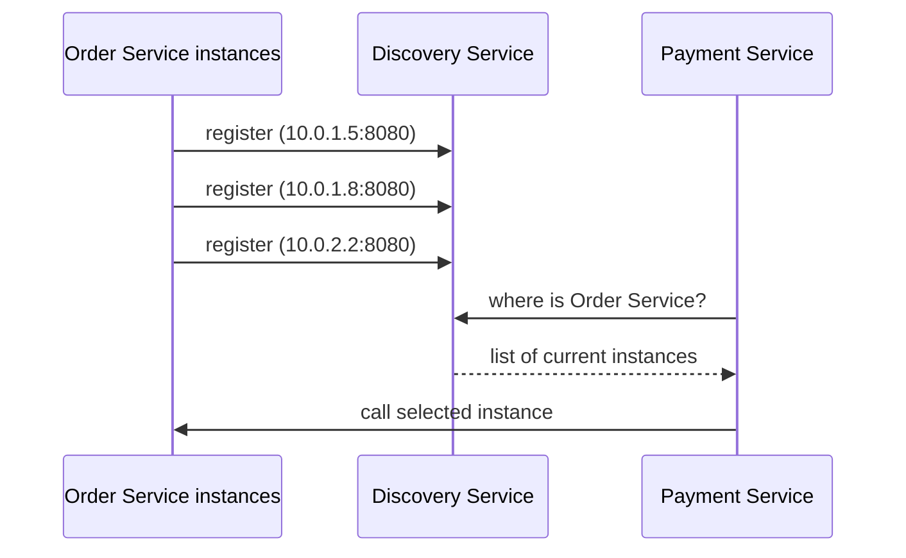

The `Payment Service` does not need to know these addresses in advance. It asks the Discovery Service where the `Order Service` is located and receives the currently available instances.

Popular implementations include:

* Netflix Eureka
* Consul
* Apache ZooKeeper
* Kubernetes Service Discovery

#### Why it is important

Without service discovery, managing hundreds of microservices would require manual configuration updates whenever a service changes location. Discovery services provide:

* Dynamic service location
* Reduced configuration complexity
* Better scalability
* Automatic adaptation to infrastructure changes

***

### API Gateway

An **API Gateway** acts as a single entry point for clients accessing a microservices-based system.

Without an API Gateway, a client application would need to communicate directly with numerous services:


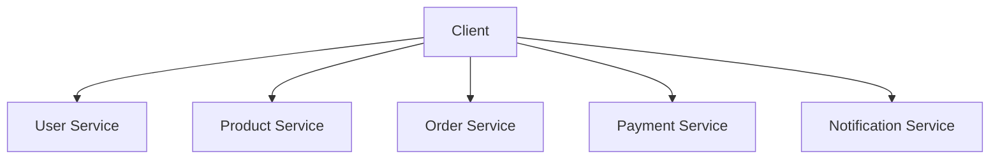

This approach creates tight coupling between clients and internal architecture.

With an API Gateway:

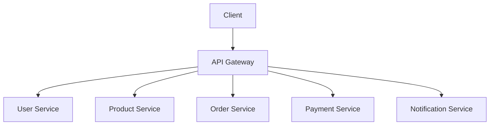

The gateway receives incoming requests and forwards them to the appropriate microservice.

Typical responsibilities include:

* Request routing
* Authentication and authorization
* SSL/TLS termination
* Rate limiting
* Logging and monitoring
* Aggregating responses from multiple services

#### Example

A mobile application requests:

```
GET /customer-dashboard
```

The gateway internally retrieves:

* User information
* Current orders
* Payment details
* Notifications

and returns a single consolidated response to the client.

Popular solutions:

* Kong
* NGINX Gateway
* Spring Cloud Gateway
* Azure API Management
* Amazon API Gateway

#### Why it is important

The API Gateway simplifies client applications and protects internal services. It also centralizes security, monitoring, and traffic management.

***

### Load Balancer

A **Load Balancer** distributes incoming traffic across multiple instances of the same service.

Consider a Product Service running on three servers:


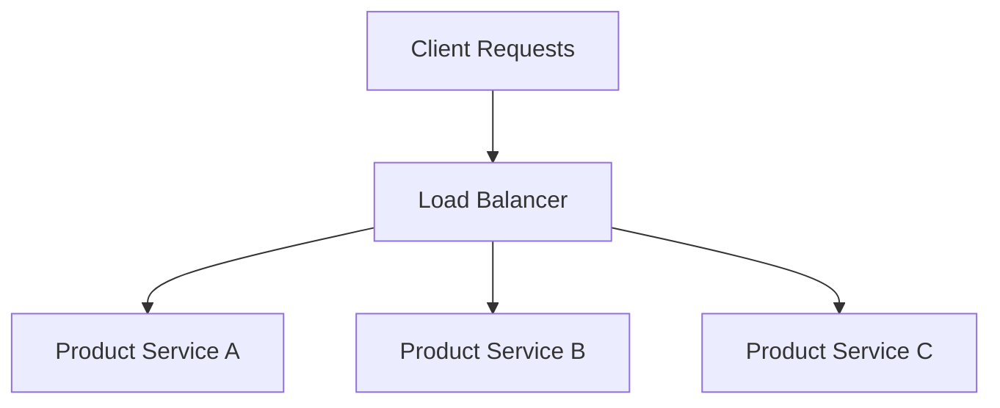

The load balancer decides which instance will handle each request.

Common strategies include:

* Round Robin
* Least Connections
* Weighted Distribution
* Response-Time-Based Routing

#### Example

Suppose 3000 requests arrive simultaneously.

Without load balancing:

```
3000 requests -> one server
```

Result:

* High latency
* Possible crashes

With load balancing:

```
1000 -> Server A
1000 -> Server B
1000 -> Server C
```

Result:

* Better performance
* Increased reliability
* Higher availability

#### Why it is important

Microservices frequently scale horizontally by creating additional instances. Load balancers ensure efficient traffic distribution and eliminate single points of failure.

***

### Circuit Breaker Pattern

Microservices constantly communicate with each other over networks. Unlike local function calls, network communication can fail due to latency, congestion, crashes, or temporary outages.

The **Circuit Breaker Pattern** protects a system from cascading failures.

The concept originates from electrical engineering. A circuit breaker disconnects a faulty electrical circuit to prevent further damage. Microservices apply the same principle.

#### States of a Circuit Breaker

**Closed**

Normal operation.

```
Service A ---> Service B
```

Requests are allowed.

**Open**

Too many failures detected.

```
Service A --X--> Service B
```

Requests are blocked immediately.

The calling service receives an error or fallback response.

**Half-Open**

After a waiting period, a limited number of test requests are allowed.

```
Service A ---> Service B ?
```

If successful, the circuit closes again. Otherwise, it reopens.

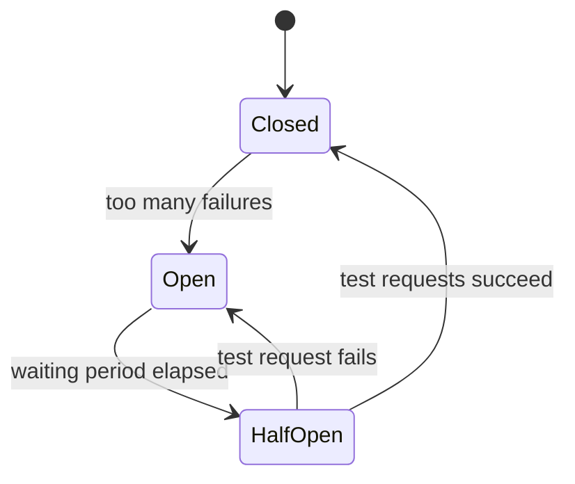
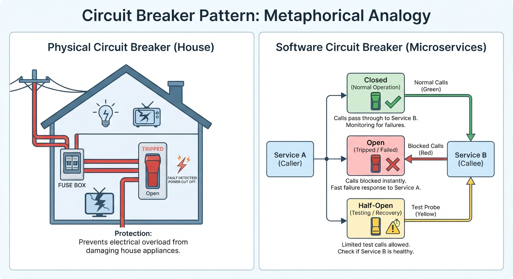

#### Example

An online store uses:

```
Order Service
      │
      ▼
Payment Service
```

If the Payment Service becomes unavailable and the Order Service continues retrying thousands of requests, the entire system may become overloaded.

A circuit breaker temporarily stops requests and prevents resource exhaustion.

Popular frameworks:

* Resilience4j
* Netflix Hystrix (legacy)
* Istio
* Envoy

#### Why it is important

The Circuit Breaker Pattern increases:

* Fault tolerance
* System stability
* Resource efficiency
* User experience during failures

***

### Workflow & Orchestration

Business processes often require cooperation among multiple microservices.

Example:

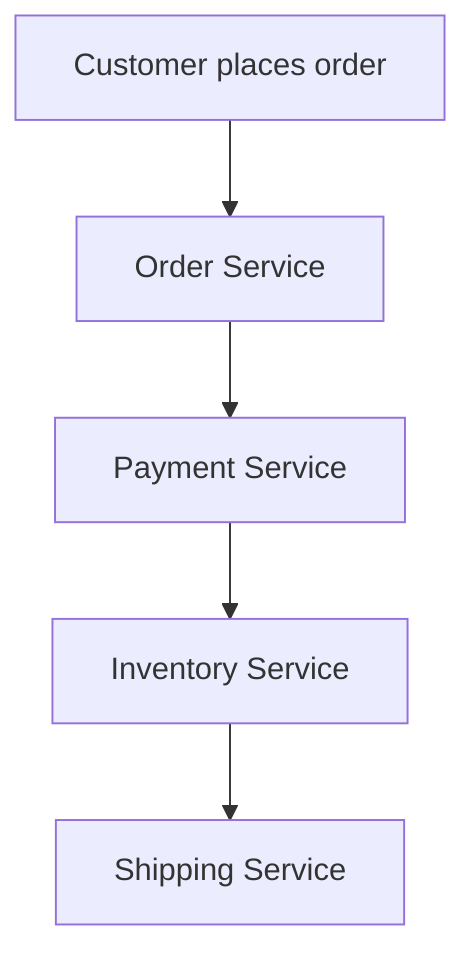

A complete business operation involving multiple services is called a **workflow**.

The question is who coordinates these activities.

#### Choreography

Each service reacts to events independently.

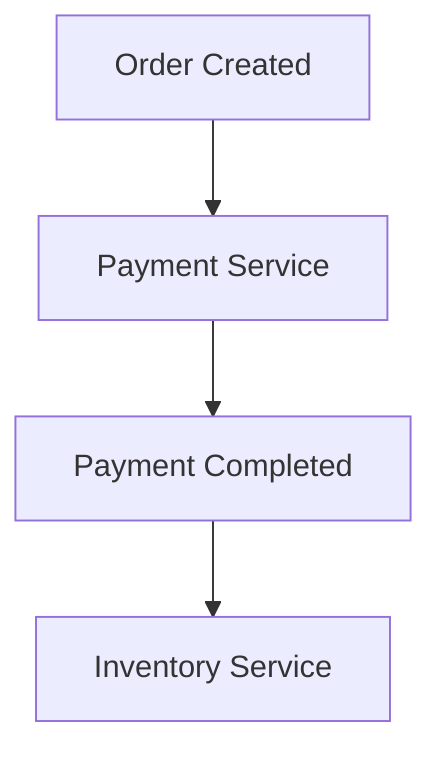

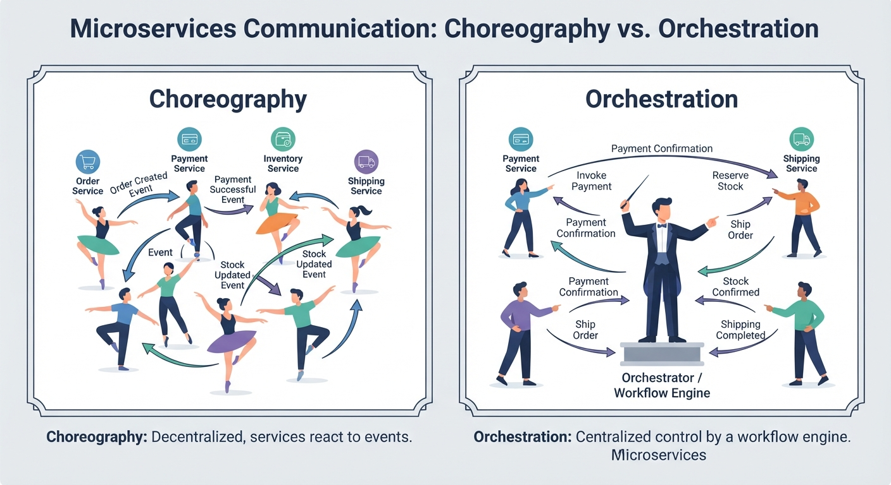

No central controller exists.

Advantages:

* High decoupling
* Greater flexibility

Disadvantages:

* Difficult monitoring
* Complex debugging

#### Orchestration

A central component controls the workflow.

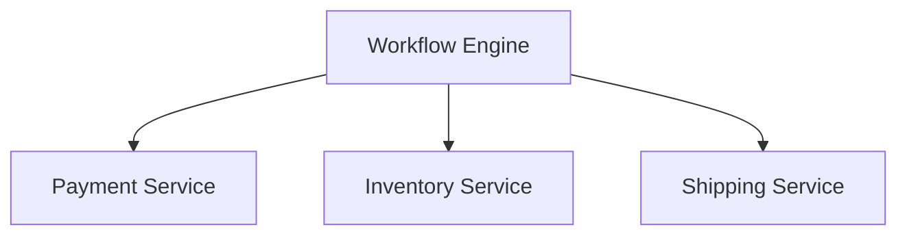

The orchestrator determines which service should execute next and handles failures.

Popular orchestration platforms:

* Camunda
* Temporal
* Netflix Conductor
* Apache Airflow
* Kubernetes (for service orchestration)

#### Why it is important

Large business processes may involve dozens of services. Orchestration provides:

* Centralized process control
* Better observability
* Easier error recovery
* Consistent execution of business rules

***

### Chaos Monkey

As systems become more distributed, failures become inevitable rather than exceptional. Servers crash, networks disconnect, and databases become unavailable.

**Chaos Monkey** is a resilience-testing tool originally developed by Netflix as part of its "Chaos Engineering" initiative.

The idea is intentionally simple:

> Deliberately introduce failures into a production-like environment to verify whether the system can survive them.

For example, Chaos Monkey may randomly terminate running service instances:

```
Current Services:
- Product Service #1
- Product Service #2
- Product Service #3

Chaos Monkey:
Terminate Product Service #2
```

The system should continue functioning because the remaining instances take over.

#### Typical Chaos Experiments

* Shutting down service instances
* Simulating network failures
* Increasing latency
* Disconnecting databases
* Restricting resources (CPU, memory)

#### Example

Suppose an e-commerce application uses:

```
3 Payment Service instances
```

If one instance unexpectedly fails, users should not notice any disruption because the load balancer redirects traffic to healthy instances.

Chaos Monkey verifies that this assumption is actually true.

#### Why it is important

Microservices architectures assume failures will occur. Chaos Engineering validates that resilience mechanisms such as:

* Load Balancers
* Discovery Services
* Circuit Breakers
* Auto-Scaling
* Redundancy

work correctly under real failure scenarios.

Without such testing, many organizations discover weaknesses only during actual outages.

***

#### Relationship Between These Concepts

Together, these components form the foundation of a robust microservices platform:

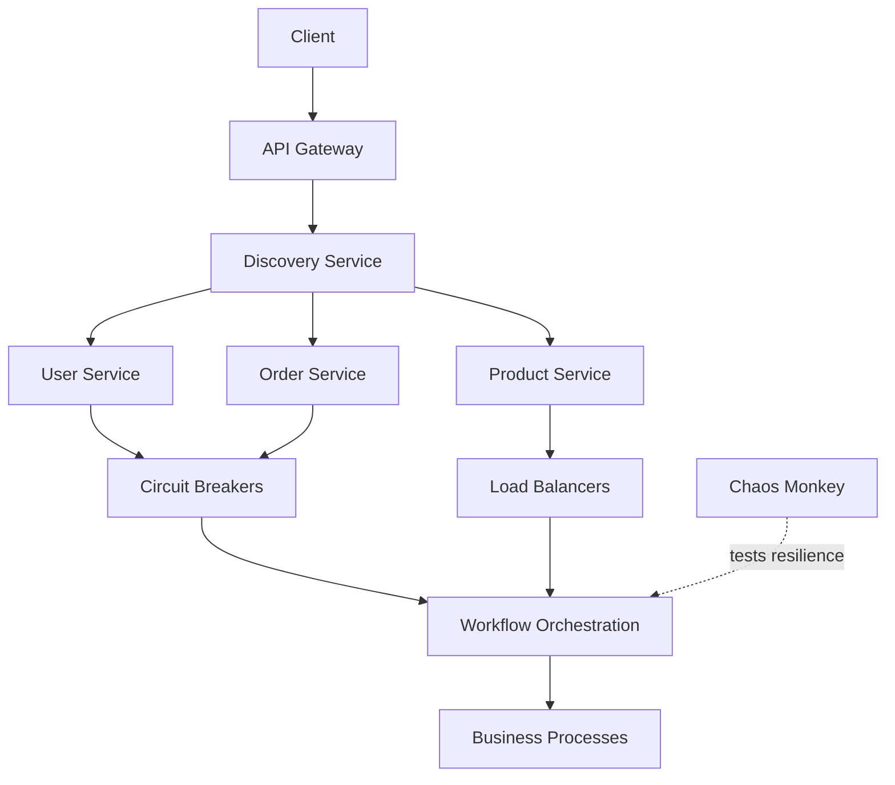

Chaos Monkey continuously tests the resilience of the entire system.

These concepts are rarely deployed in isolation. In modern cloud-native platforms, they complement each other to provide **scalability, resilience, fault tolerance, maintainability, and operational reliability**, which are the primary goals of a microservices architecture.

## Software Enablers

While architectural concepts such as service discovery, API gateways, or circuit breakers define how microservices cooperate, their practical implementation requires a technology stack that supports development, deployment, operation, and management of distributed systems. Modern microservice-based solutions commonly rely on frameworks and platforms such as Spring Boot, Spring Cloud, Docker, Kubernetes, and Istio.

### Spring Boot

**Spring Boot** is a Java-based framework that simplifies the development of standalone applications and microservices. It is built on top of the Spring Framework and aims to reduce configuration effort through sensible defaults and automated setup.

Before Spring Boot, developers often had to manually configure application servers, dependencies, and framework components. Spring Boot automates much of this process and enables developers to create production-ready services with minimal boilerplate code.

A typical Spring Boot microservice can be created with only a few classes:

```
@SpringBootApplication
public class ProductServiceApplication {
    public static void main(String[] args) {
        SpringApplication.run(ProductServiceApplication.class, args);
    }
}
```

and a simple REST controller:

```
@RestController
public class ProductController {

    @GetMapping("/products")
    public List<Product> getProducts() {
        return productRepository.findAll();
    }
}
```

#### Why It Is Important for Microservices

Spring Boot provides:

* Rapid application development
* Embedded web servers (Tomcat, Jetty, Undertow)
* Easy creation of REST APIs
* Integration with databases
* Production monitoring via Spring Actuator
* Simplified dependency management

As a result, Spring Boot has become one of the most popular frameworks for implementing microservices in Java ecosystems.

***

### Spring Cloud

While Spring Boot focuses on developing individual services, **Spring Cloud** provides tools required to build entire distributed systems.

Microservice architectures introduce new challenges:

* Service discovery
* Configuration management
* Distributed communication
* Fault tolerance
* Gateway management
* Distributed tracing

Spring Cloud provides ready-made solutions for these concerns.

Typical Spring Cloud components include:

| Component                      | Purpose                          |
| ------------------------------ | -------------------------------- |
| Spring Cloud Gateway           | API Gateway                      |
| Eureka                         | Service Discovery                |
| Config Server                  | Centralized Configuration        |
| OpenFeign                      | Service-to-Service Communication |
| Circuit Breaker (Resilience4j) | Fault Tolerance                  |
| Sleuth / Micrometer            | Distributed Tracing              |

#### Example

Instead of manually locating another service:

[http://10.0.1.8:8080/products](http://10.0.1.8:8080/products)

a Spring Cloud application can simply call:

[http://PRODUCT-SERVICE/products](http://product-service/products)\`\`

and the service discovery mechanism automatically resolves the address.

#### Why It Is Important for Microservices

Spring Cloud implements many architectural patterns discussed earlier:

* Discovery Service
* API Gateway
* Circuit Breaker
* Centralized Configuration
* Distributed Monitoring

Consequently, it significantly reduces the implementation effort required to build a complete microservice ecosystem.

***

### Docker and Podman

A microservice is typically packaged as a **container**.

A container is a lightweight, isolated execution environment that contains:

* Application code
* Runtime environment
* Libraries
* Configuration

The most widely used container platform is **Docker**. An increasingly popular alternative is **Podman**, which provides similar functionality but offers a daemonless architecture and improved security characteristics.

For example, a Spring Boot application can be packaged using a Dockerfile:

```
FROM eclipse-temurin:21-jdk
COPY app.jar app.jar
ENTRYPOINT ["java", "-jar", "app.jar"]
```

Building the image:

```
docker build -t product-service .
```

Running the container:

```
docker run -p 8080:8080 product-service
```

#### Why Containers Are Important

Without containers:

* Applications behave differently across environments.
* Dependency conflicts occur frequently.
* Deployment becomes complex.

Containers ensure:

* Environment consistency
* Platform independence
* Fast deployment
* Easy scalability
* Resource isolation

The famous principle:

> "It works on my machine."

is largely eliminated through containerization.

***

### Container Orchestration: Kubernetes

Running a few containers manually is manageable. Running hundreds or thousands of containers across multiple servers is not.

This problem is solved by a **container orchestrator**.

The most widely adopted orchestration platform today is **Kubernetes (K8s)**.

Kubernetes automates:

* Container deployment
* Service discovery
* Load balancing
* Scaling
* Recovery from failures
* Configuration management
* Secret management

A typical deployment architecture looks as follows:

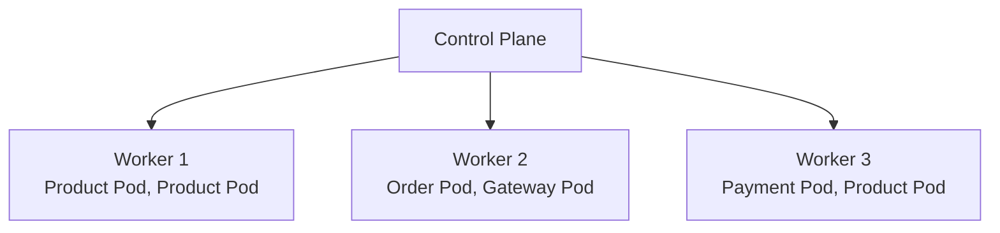

If a container crashes, Kubernetes automatically creates a replacement instance.

#### Why Kubernetes Is Important

Large microservice systems require automated operations.

Kubernetes provides:

* Automatic scaling
* High availability
* Self-healing capabilities
* Integrated service discovery
* Rolling updates
* Infrastructure abstraction

Without orchestration platforms, managing large microservice environments would become extremely complex and costly.

### Istio (Service Mesh Implementation)

As systems grow, service-to-service communication itself becomes increasingly complex.

Consider a system with 100 microservices.

Each service may require:

* Mutual TLS (mTLS)
* Traffic routing
* Retry policies
* Circuit breaking
* Load balancing
* Observability
* Fault injection

Implementing these features independently within every service would create substantial duplication and maintenance overhead.

This challenge is addressed by a **Service Mesh**.

A service mesh is an infrastructure layer responsible for managing communication between services.

**Istio** is one of the most widely used service mesh implementations.

#### How Istio Works

Istio deploys a lightweight **sidecar proxy** (typically Envoy) alongside each microservice instance.

All network traffic passes through these proxies.

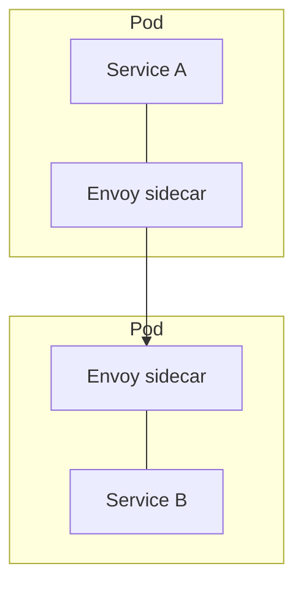

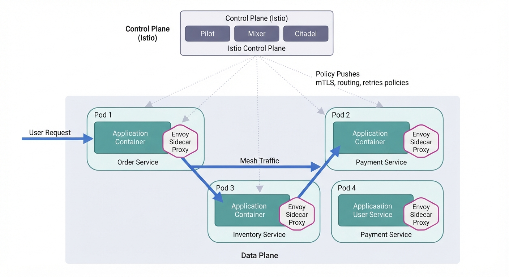

This approach allows Istio to manage communication without modifying application code.

#### Key Features

**Traffic Management**

Istio supports:

* Load balancing
* Canary releases
* Blue-green deployments
* Traffic splitting

Example:

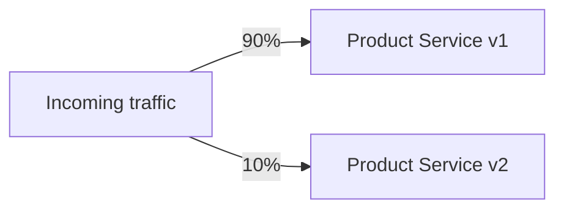

This enables gradual deployment of new versions.

**Security**

Istio can automatically enforce:

* Mutual TLS (mTLS)
* Identity management
* Access policies

**Reliability**

Istio supports:

* Circuit breakers
* Retries
* Timeouts
* Fault injection

**Observability**

Istio collects detailed telemetry data:

* Request counts
* Latency metrics
* Error rates
* Distributed traces

#### Why Istio Is Important

As microservice environments scale, networking concerns become as important as business logic.

Istio centralizes and standardizes:

* Security policies
* Communication management
* Reliability mechanisms
* Monitoring and tracing

without requiring developers to implement these capabilities repeatedly in each service.

***

### Relationship Between These Technologies

These technologies complement one another and together form a modern cloud-native microservices platform:

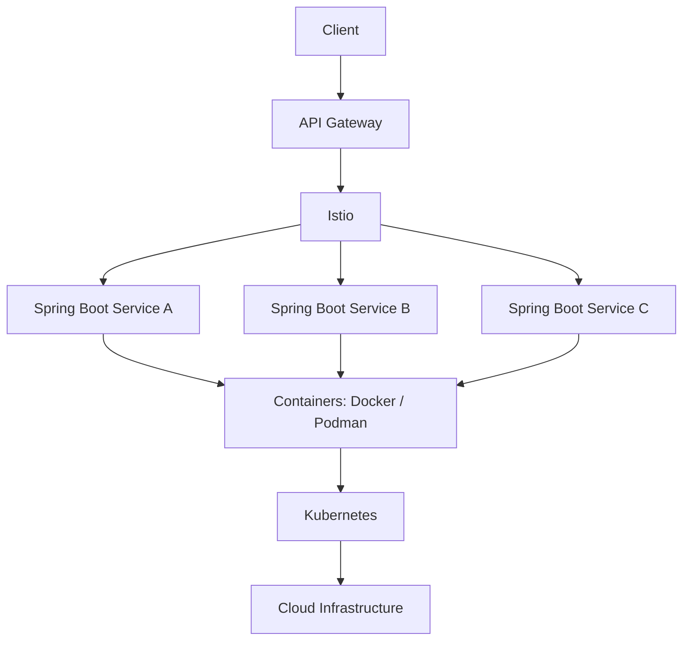

In this architecture:

* **Spring Boot** implements individual microservices.
* **Spring Cloud** provides distributed-system capabilities.
* **Docker/Podman** package services into containers.
* **Kubernetes** manages and orchestrates containers.
* **Istio** controls communication between services.

Together, these technologies provide the foundations for building **scalable, resilient, maintainable, and cloud-native microservice architectures**.

## Microservice Decomposition Strategies

One of the key design activities in a microservices architecture is **decomposition**, which is the process of dividing a large system into smaller, manageable services. The goal of decomposition is to improve scalability, maintainability, performance, and team autonomy. Different decomposition strategies can be applied depending on the system's requirements and characteristics.

### Horizontal Decomposition

**Horizontal decomposition** (sometimes referred to as horizontal scaling) involves creating multiple identical instances of the same microservice. Each instance performs exactly the same functionality, and incoming requests are distributed among them.

A load balancer is typically used to spread traffic across available instances, while platforms such as Kubernetes automatically manage instance creation, removal, and health monitoring.

Example:

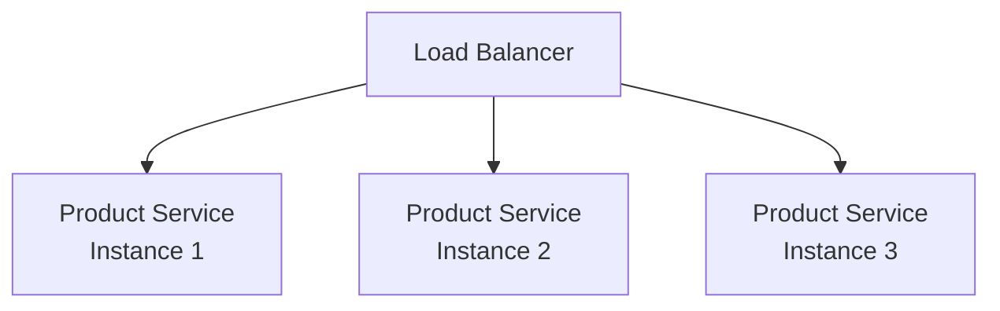

If user demand increases, additional instances can be started automatically:

3 instances → 6 instances → 12 instances

#### Advantages

* Simple scalability
* Higher availability
* Better fault tolerance
* Efficient resource utilization

#### Typical Use Cases

* Web applications
* REST APIs
* Stateless business services
* High-traffic systems

***

### Functional Decomposition

**Functional decomposition** divides a system according to business functionality. Each microservice is responsible for a different business domain or feature.

Instead of replicating the same functionality, services perform different tasks.

Example:

User ServiceProduct ServiceRecommendation ServiceNews ServiceOrder ServicePayment Service

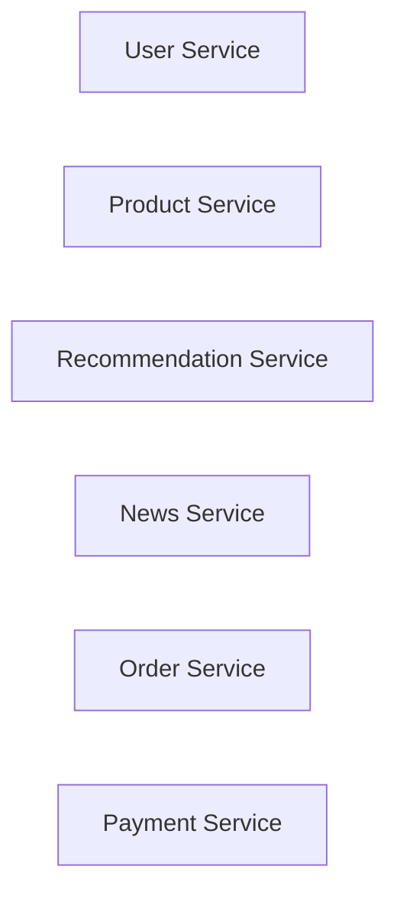

Each service manages its own logic and data.

A functional decomposition may also separate users according to their role or system behavior:

Anonymous User ServiceRegistered User ServiceAdministrator

or

Customer Portal ServiceBackoffice Service

#### Advantages

* Clear business boundaries
* Easier maintenance
* Independent development teams
* Improved modularity
* Better business alignment

#### Typical Use Cases

* E-commerce systems
* Enterprise information systems
* Banking platforms
* SaaS applications

The majority of microservice architectures primarily use functional decomposition because it aligns naturally with business capabilities.

***

### Data Decomposition

**Data decomposition** (also known as data partitioning or sharding) distributes data across multiple service instances, where each instance is responsible for only a subset of the overall dataset.

Instead of processing all records, each instance manages a specific partition.

Example based on alphabetical ranges:

Customer Service A-ECustomer Service F-LCustomer Service M-QCustomer Service R-Z

Requests are routed according to the customer's surname.

For example:

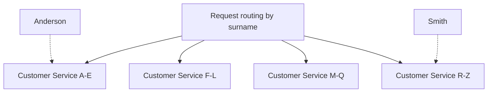

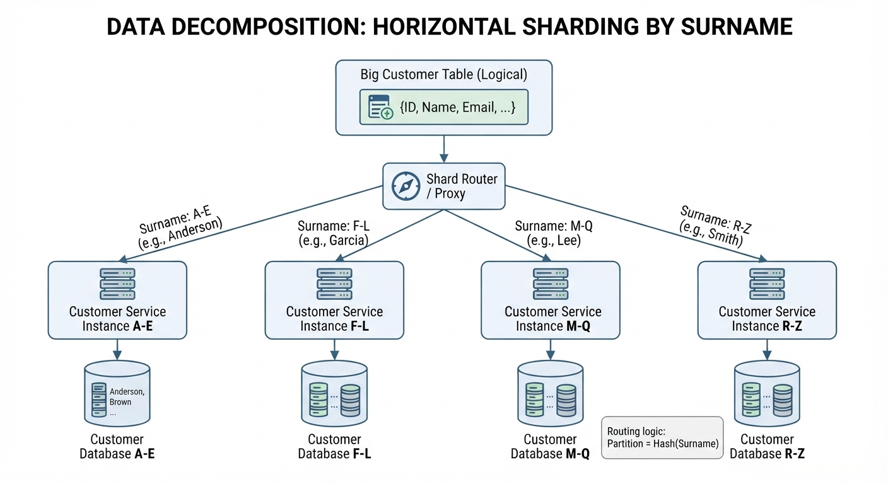

Another common partitioning method is based on:

* Geographic regions
* Customer identifiers
* Product categories
* Numerical ranges
* Tenant identifiers in multi-tenant systems

#### Advantages

* Better scalability for large datasets
* Reduced database bottlenecks
* Improved performance
* More efficient storage management

#### Typical Use Cases

* Social networks
* Search engines
* Large online stores
* Big data systems
* Global cloud applications

#### Challenges

Data decomposition introduces additional complexity:

* Cross-partition queries
* Data consistency
* Data migration
* Rebalancing partitions

Therefore, it is usually applied only when the volume of data exceeds the capabilities of a single service instance or database.

***

### Combining Decomposition Strategies

In practice, these decomposition approaches are rarely used in isolation. Most large-scale systems combine multiple strategies simultaneously.

For example:

```mermaid
flowchart TD
    G["API Gateway"] --> P["Product Service (functional)"]
    G --> U["User Service (functional)"]
    G --> R["Recommendation Service (functional)"]
    P --> P1["A-F Partition (data)"]
    P --> P2["G-L Partition (data)"]
    P --> P3["M-R Partition (data)"]
    P --> P4["S-Z Partition (data)"]
    P1 --> K["Multiple replicas via Kubernetes (horizontal)"]
    P2 --> K
    P3 --> K
    P4 --> K
```

In this example:

1. **Functional decomposition** separates the system into Product, User, and Recommendation services.
2. **Data decomposition** partitions product data according to alphabetical ranges.
3. **Horizontal decomposition** runs multiple replicas of each partition for scalability and high availability.

#### Why Combination Is Important

Different decomposition strategies solve different problems:

| Strategy                 | Primary Goal                                |
| ------------------------ | ------------------------------------------- |
| Functional Decomposition | Separation of business responsibilities     |
| Data Decomposition       | Scaling large datasets                      |
| Horizontal Decomposition | Scaling workload and improving availability |

Modern cloud-native systems commonly combine all three approaches to achieve both business modularity and technical scalability. The ability to mix decomposition strategies is one of the major reasons why microservices can support systems consisting of hundreds of services and millions of users while remaining manageable and resilient.
