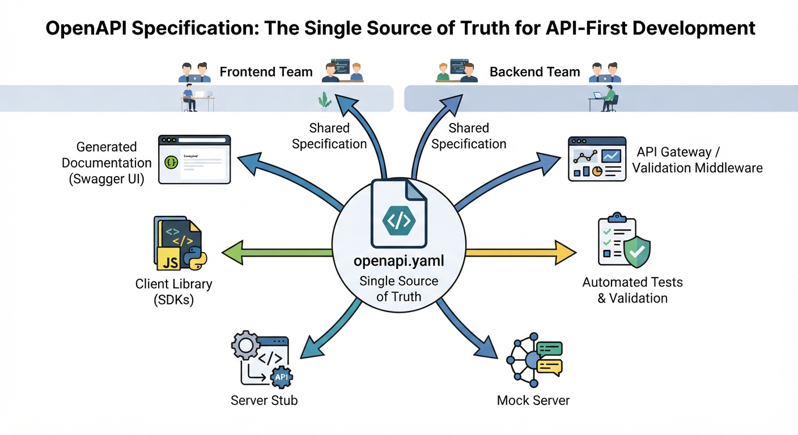

# OpenAPI, Swagger

### OpenAPI and Swagger

As REST APIs became the dominant mechanism for communication between client and server applications, a recurring problem emerged. Although developers could implement an API relatively easily using HTTP, there was often no standardized way to describe the available endpoints, required parameters, request formats, response structures, authentication methods, or error codes. API documentation was frequently created manually, became outdated over time, and often differed from the actual implementation.

To address this problem, the concept of a **machine-readable API specification** was introduced. The idea was to create a standardized description of an API that could be understood not only by developers but also by tools. This led to the creation of the **OpenAPI Specification (OAS)**, which has become the de facto standard for describing REST APIs.

OpenAPI defines a structured document, typically written in YAML or JSON, that formally describes all aspects of an API. Instead of documenting endpoints in a text document or wiki page, the API contract is expressed in a format that can be processed automatically.

A simplified example of an OpenAPI specification is shown below:

```
openapi: 3.0.0

paths:
  /customers/{id}:
    get:
      summary: Get customer information
      parameters:
        - name: id
          in: path
          required: true
          schema:
            type: integer

      responses:
        '200':
          description: Customer found
```

This specification describes an endpoint accessible through the HTTP GET method. It states that the endpoint requires an `id` path parameter and may return a successful response with status code 200.

The key idea behind OpenAPI is that the specification becomes the **contract** between API providers and API consumers. Both sides can independently develop their software while relying on a shared description of the interface.

Closely associated with OpenAPI is **Swagger**. Historically, Swagger was the original project that introduced the specification and related tooling. When the specification was later transferred to the OpenAPI Initiative and standardized as OpenAPI, the Swagger name remained associated primarily with a set of tools built around the specification.

Today, the terms are often confused. Strictly speaking:

* **OpenAPI** is the specification (the standard).
* **Swagger** is a collection of tools implementing and utilizing that specification.

The most widely used Swagger tool is **Swagger UI**, which generates an interactive web interface directly from an OpenAPI document. Instead of reading static documentation, developers can browse endpoints, view request and response models, and even execute API calls directly from the browser.

TODO IMG: Mock-up of a Swagger UI page: a list of colored endpoint rows (green GET /customers/{id}, blue POST /customers, red DELETE /customers/{id}), with one row expanded showing parameters, a response schema, example JSON and a 'Try it out' button. Clean UI mock-up, flat style, English labels.

A typical Swagger UI page presents information such as:

```
GET  /customers/{id}
POST /customers
DELETE /customers/{id}
```

Expanding an endpoint reveals:

* endpoint description,
* available parameters,
* request body structure,
* response schemas,
* HTTP status codes,
* example requests and responses.

Many implementations also provide a **Try it out** button, allowing developers to invoke the API directly from the documentation interface.

The existence of a formal API specification enables a wide range of automation. Development tools can automatically generate:

* client libraries,
* server stubs,
* API documentation,
* testing tools,
* validation logic,
* mock servers.

For example, given an OpenAPI specification, a Java application can automatically generate strongly typed client classes and support the endpoint invocation:

```
CustomerApi api = new CustomerApi();

Customer customer =
        api.getCustomerById(123);
```

Without OpenAPI, such client code would need to be written manually.

OpenAPI plays a particularly important role in microservice architectures. When dozens or hundreds of services communicate with one another, manually maintaining documentation becomes impractical. The API specification becomes a single source of truth from which documentation, tests, and client code can all be generated automatically.



For this reason, OpenAPI is often considered an example of the **API First** approach. In this methodology, developers first define the API contract and only then implement the service itself. This reduces misunderstandings between teams, encourages consistency, and allows parallel development of clients and servers.

In modern software systems, OpenAPI and Swagger have become essential tools for designing, documenting, testing, and consuming REST APIs. They transform API documentation from a human-readable description into a machine-readable contract that can serve as the foundation for a broad ecosystem of development and integration tools.
