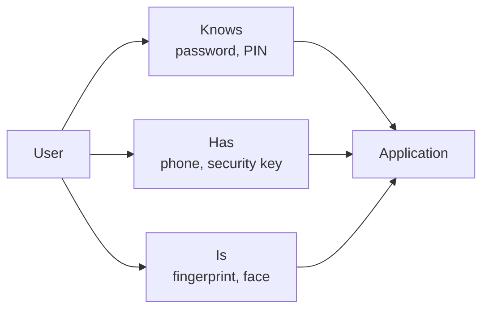
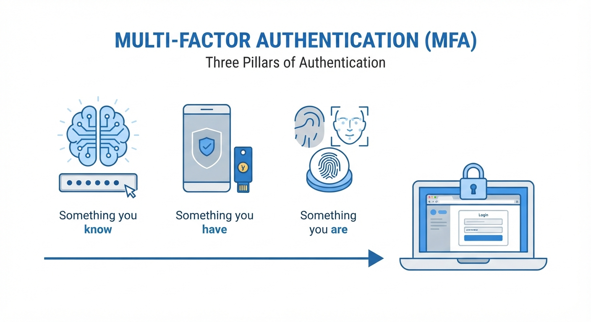
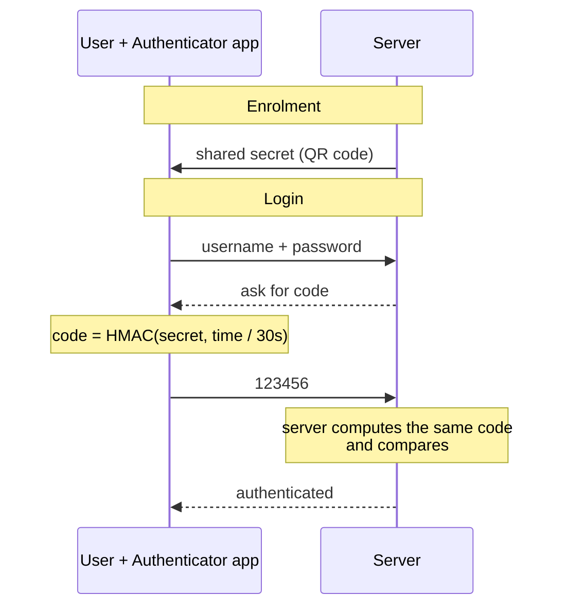
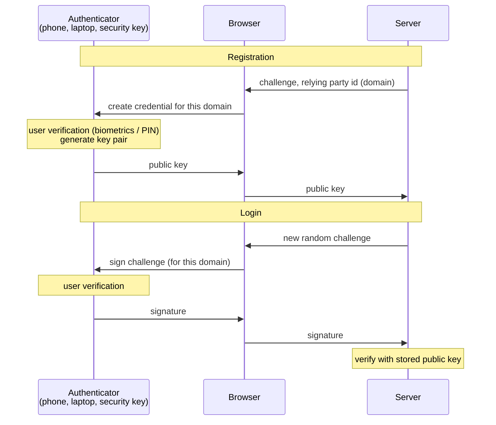
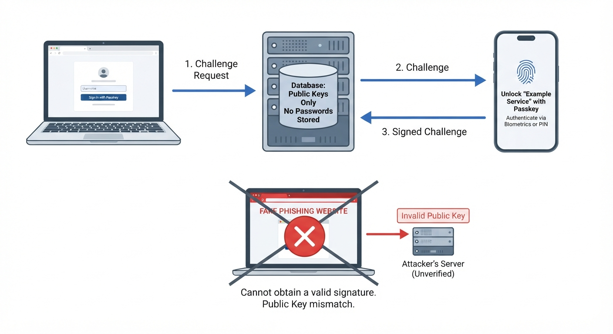
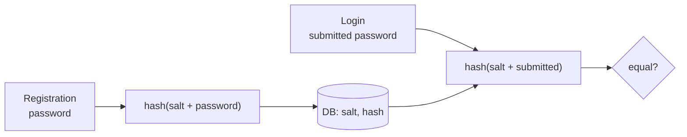

# Security - Authentication

## Basic Terms

Every web application that works with user-specific data has to answer two questions: *who is sending this request* and *what is this person allowed to do*. This chapter deals with the first one, **authentication** (often shortened to *AuthN*). The second question, **authorization** (*AuthZ*), is covered in [Security - Authorization](security-authorization.md).

Authentication is the process of verifying that a subject really is who it claims to be. The subject is usually a human user, but it may also be another service or a device. The claimed identity is called an **identity** (for example a username or an e-mail address), and the evidence that supports the claim is called a **credential** (for example a password). The system that stores identities and verifies credentials is sometimes called an **identity provider** (IdP). In small applications the IdP is simply a table in the application's own database; in larger environments it is a separate service (see [User Registration / Password Management / IdP](../general-topics/user-registration-password-management-idp.md)).

It is important not to confuse authentication with *identification* and *authorization*. Identification means only stating who you are ("I am alice"). Authentication proves it ("and here is the proof"). Authorization decides what the proven identity may do. A successful login also does not end the story: because HTTP is stateless, the application must remember the result of the authentication for the following requests, typically using a session or a token (see [Security - Authorization](security-authorization.md)).

## Authentication Factors

The evidence a user can present is traditionally divided into categories called **authentication factors**. The classical three are:

* **Something you know** - knowledge, a secret kept in your head: a password, a passphrase, a PIN, an answer to a security question.
* **Something you have** - possession of a physical or virtual object: a smartphone with an authenticator app, a hardware security key, a bank card, an SMS-capable SIM card.
* **Something you are** - inherence, a biometric property: a fingerprint, a face, an iris, a voice.

Some authors add further factors such as *somewhere you are* (location, IP range) or *something you do* (behavioural biometrics such as typing rhythm), but these are rather used as supporting signals than as stand-alone proof.

The real strength comes from **combining factors from different categories**. This is called **multi-factor authentication (MFA)**; the most common variant is **two-factor authentication (2FA)**. An attacker who steals a password database still does not have the victim's phone. Note that two passwords are *not* two factors: both belong to the "something you know" category and are typically compromised by the same attack (phishing, keylogger, leaked database). Similarly, a password followed by a security question is just one factor used twice.





## Overview of Authentication Mechanisms

The following sections present the most common mechanisms used in web applications today. Each is evaluated from four perspectives: advantages, disadvantages, security, and implementation complexity. A summary table is at the end of the chapter.

### Username and Password

The oldest and still the most widespread mechanism. The user registers with a username (often an e-mail address) and a password. During login, the application compares the submitted password with the stored one.

The crucial rule is that the application must **never store passwords in plain text** or encrypt them reversibly. Instead, it stores a **hash** produced by a slow, salted, purpose-built algorithm such as **Argon2id**, **bcrypt** or **scrypt**. A *salt* is a random value unique to each user that is mixed into the hash, so that two users with the same password have different hashes and precomputed ("rainbow") tables are useless. The slowness (a configurable *work factor*) makes brute-force attacks expensive. General-purpose fast hashes such as MD5 or plain SHA-256 are not suitable for this purpose.

In Spring Boot, the whole topic is handled by the `PasswordEncoder` abstraction:

```java
@Bean
PasswordEncoder passwordEncoder() {
    return new BCryptPasswordEncoder(); // or Argon2PasswordEncoder
}

// registration
user.setPasswordHash(passwordEncoder.encode(rawPassword));

// login
boolean ok = passwordEncoder.matches(rawPassword, user.getPasswordHash());
```

The main advantage of passwords is that everybody understands them, no special hardware is needed and the implementation is simple. The disadvantages are well known: people choose weak passwords, reuse them across sites, and write them down. Passwords can be guessed, phished, stolen by malware, or leaked from a breached site. The application must therefore add protection around the mechanism: rate limiting and temporary lockouts against brute-force and credential-stuffing attacks, checks against lists of leaked passwords, secure password-reset flow, and always HTTPS.

In terms of security a password alone is **low to medium**; the implementation complexity is **low**, although a correct and complete solution (registration, e-mail verification, password reset, lockout) is larger than it first appears.

### Passphrases

A passphrase is not a different technology but a different *policy*: instead of a short, complex password such as `P@ssw0rd!`, the user chooses a long sequence of words, for example `correct horse battery staple`. Security depends mostly on **length and unpredictability** rather than on character variety. A passphrase made of four or more randomly chosen words is much harder to brute-force than a short password with special characters, yet much easier to remember. Current recommendations (for example NIST SP 800-63B) therefore favour long passwords, allow all characters including spaces, and discourage forced periodic changes and arbitrary composition rules.

From the implementation point of view, passphrases are the same as passwords: they are hashed and verified in the same way. The server must simply permit long inputs (tens of characters, and set a sensible upper bound, for example 64 or 128 characters, to prevent denial of service by hashing megabytes of data) and should not impose strange rules. The weakness remains: a passphrase is still a shared secret, it can be phished or reused, and the user may choose a famous quotation that is easy to guess. Security is **medium**, implementation complexity is **low** (often even lower than for complex password policies).

### Password Plus a Second Factor

Because of the weaknesses of passwords, most serious applications add a second factor. There are several variants, which differ considerably in strength.

#### SMS or E-mail One-Time Codes

After entering the password, the server sends a short numeric code to the user's phone or e-mail, and the user types it back. Its biggest advantage is that nearly everyone can use it without installing anything. However, SMS is considered the weakest second factor: messages can be intercepted, and attackers can perform *SIM swapping* (convincing the operator to move the victim's number to another SIM). Codes can also be phished in real time by a fake website that relays them to the real one. E-mail codes are only as secure as the mailbox. Sending SMS also costs money and depends on an external gateway. Security is **low to medium** (better than no second factor, though), complexity is **low to medium** (a gateway, code generation, expiry and attempt limits).

#### TOTP Authenticator Applications

**TOTP** (Time-based One-Time Password, RFC 6238) is the mechanism behind applications such as Google Authenticator, Microsoft Authenticator, Authy or 2FAS. During enrolment, the server generates a random **shared secret** and shows it to the user as a QR code. The application stores it. Afterwards both sides can compute the same six-digit code from the secret and the current time (typically in 30-second windows), without any communication:



The advantages are that it works offline, costs nothing, is independent of the phone network, and is supported by many libraries. Disadvantages: the secret is stored on the server in recoverable form (it cannot be hashed, because the server needs it to compute the code), so a database leak exposes it; users who lose their phone must use backup codes; and the code can still be **phished** in real time, because it is just a number the user types into whichever site asks for it. Security is **medium to high**, complexity is **medium** (secret generation, QR code, secure storage of secrets, clock-drift tolerance, recovery codes). In Java, libraries exist so that you do not have to implement the algorithm yourself.

#### Push Notifications

The user receives a notification in the provider's mobile application and approves or denies the login. It is very convenient, but vulnerable to *MFA fatigue* (an attacker repeatedly triggers prompts until the exhausted user taps "approve"). Mitigations include *number matching*, where the user must type a number displayed on the login screen into the phone. It requires a mobile application and a push infrastructure, so the implementation complexity is **high** unless a third-party service is used.

### Hardware Security Keys and Passkeys (WebAuthn / FIDO2)

This is the most modern and most secure family of mechanisms. It is based on the **WebAuthn** standard (W3C) and the **FIDO2** protocols, and replaces the shared secret with **public-key cryptography**.

During registration, the user's device (an *authenticator*) generates a key pair **for that specific website**. The private key never leaves the authenticator; the public key is sent to the server and stored with the user's account. During login, the server sends a random **challenge**, the authenticator signs it with the private key after the user confirms locally (by fingerprint, face, PIN or by touching the key), and the server verifies the signature using the stored public key.



The most important property is that the credential is **bound to the domain**. The browser tells the authenticator which origin it is talking to, so a phishing site on `examp1e.com` simply cannot obtain a signature valid for `example.com`. This makes WebAuthn **phishing-resistant**, which neither passwords nor TOTP are. Another benefit is that the server stores only public keys, so a database breach is not catastrophic, and there is no secret to be reused between sites.

There are two kinds of authenticators. **Hardware security keys** (YubiKey and similar) are dedicated USB/NFC devices. **Passkeys** are discoverable credentials that are stored on the user's device and usually **synchronized** through the platform's cloud account (Apple iCloud Keychain, Google Password Manager, Microsoft, or third-party password managers), so that they survive device loss and work across the user's devices. Passkeys can fully replace the password (a *passwordless* login) while still combining two factors in one gesture: possession of the device and a local biometric or PIN check.

The disadvantages are mainly practical. The ecosystem is still evolving and users are not yet familiar with it. Account recovery is difficult (what if the user loses all devices?), synchronized passkeys depend on the security of the cloud account, and hardware keys cost money. Implementation complexity is **medium to high**: the protocol has many details (challenge handling, origin and attestation checks, counters, credential storage), so in practice you should use a well-tested library (for example *Yubico java-webauthn-server* or Spring Security's built-in passkey support in recent versions) and not write the cryptography yourself. Security is **very high**.



### Biometrics

Biometrics (fingerprint, face recognition) are very convenient, but they have an important property: they are not secrets (your face is visible, fingerprints are left on glasses) and they **cannot be changed** after they leak. Therefore, in web applications biometrics are almost never sent to the server. Instead, they are used *locally* to unlock a private key or a stored secret, as happens in passkeys. A server that stores biometric templates has a very serious data protection responsibility (they are a special category of personal data under GDPR). For the web developer the right approach is to use biometrics only indirectly through WebAuthn.

### Magic Links and E-mail Login

In this passwordless variant, the user enters an e-mail address and receives a link with a single-use, short-lived token. Clicking the link logs them in. It is simple for users and for developers (no password storage, no reset flow), and it is used by many modern services. Its security is exactly as strong as the user's mailbox, the link can be intercepted or forwarded, and login is slower because it requires switching to the mail client. The token must be random, long, single-use and expire quickly. Security is **medium**, complexity **low to medium**.

### Federated Login, Single Sign-On and Social Login

Instead of building its own user database, the application can delegate authentication to an external identity provider (Google, Microsoft, GitHub, a corporate Keycloak, or the university's login) using standards such as **OAuth 2.0**, **OpenID Connect** (OIDC) and **SAML**. The user is redirected to the provider, authenticates there (using whatever mechanism the provider supports, including MFA and passkeys) and returns to the application with a signed proof of identity, typically a JWT (see [Security - Authorization](security-authorization.md)). When one login is reused across multiple applications, we speak about **Single Sign-On (SSO)**.

The advantages are significant: the application never touches passwords, the provider's security team handles MFA, breach detection and recovery, and users do not need another account. Disadvantages: dependence on a third party (outage or account closure), privacy concerns about the provider knowing where you log in, and a more complicated integration with redirects and configuration of trust. Security is **high**, provided the integration is done correctly; implementation complexity is **medium** (Spring Security's OAuth2 client and resource-server support reduce it considerably), but running your own IdP is **high**.

#### Example Identity Providers

There is no need to build an identity provider from scratch; many ready-made products exist. The **self-hosted open-source** group includes **Keycloak** (the most widespread, backed by the Red Hat / CNCF community), and also Authentik, Zitadel, Ory (Kratos and Hydra) or Authelia. The **cloud services** (identity as a service) include Auth0, Okta, Microsoft Entra ID, AWS Cognito, Google Identity Platform or Firebase Authentication. They all offer user registration, login pages, password reset, MFA and passkeys, social login and token issuing through OIDC/OAuth 2.0, so the application contains almost no authentication code.

Keycloak is a good example for students because it can be started in a single command thanks to Docker. A development instance with an administrator account is started as follows (never use these credentials or the `start-dev` mode in production):

```
docker run -p 8080:8080 \
  -e KC_BOOTSTRAP_ADMIN_USERNAME=admin \
  -e KC_BOOTSTRAP_ADMIN_PASSWORD=admin \
  quay.io/keycloak/keycloak:latest start-dev
```

After opening `http://localhost:8080`, you create a *realm* (an isolated space of users and applications), define a *client* (your application) and add users, either manually or via self-registration. From that moment the realm exposes standard OIDC endpoints, including the login page, the token endpoint and the JWKS endpoint with public keys (see [Security - Authorization](security-authorization.md)). A Spring Boot backend then acts only as a *resource server* and needs a single property to validate the tokens:

```
spring.security.oauth2.resourceserver.jwt.issuer-uri=http://localhost:8080/realms/myrealm
```

For a more complex setup, a `docker-compose` file with Keycloak and a database such as PostgreSQL is used, so the data survive a restart of the container. The price of this convenience is the operation of another component (updates, backups, high availability, configuration of HTTPS and proxy in production) and the learning curve of the product, which is why small projects sometimes prefer a managed cloud service.

### Other Mechanisms for Non-Human Clients

Not every client is a person at a keyboard. Services calling other services or scripts calling an API use **API keys** (a long random string identifying the caller; simple but easily leaked and usually not tied to a person), **client certificates** (mutual TLS, where both sides authenticate by certificates; very strong, but certificate management is laborious), or the **OAuth 2.0 client credentials flow** (the service obtains a token using its own ID and secret). The principle is the same: a secret or a key proves the identity.

## Summary and Comparison

The table summarizes the mechanisms. The ratings are simplified and meant as a guide only; the actual security depends heavily on the quality of the implementation.

| Mechanism | Factor | Main advantages | Main disadvantages | Security | Implementation complexity |
| --- | --- | --- | --- | --- | --- |
| Username + password | Know | Familiar, no hardware, simple | Weak and reused passwords, phishing, leaks | Low - medium | Low |
| Passphrase | Know | Easy to remember, strong when long | Still a shared secret, phishable | Medium | Low |
| SMS / e-mail code | Have | Everyone can use it, no installation | SIM swap, interception, phishable, cost | Low - medium | Low - medium |
| TOTP app | Have | Offline, free, standard | Secret on the server, phishable, device loss | Medium - high | Medium |
| Push approval | Have | Very convenient | MFA fatigue, needs mobile app | Medium | High |
| Passkey / security key (WebAuthn) | Have + Know/Are | Phishing-resistant, no shared secret, passwordless | Recovery, new technology, cloud account dependency | Very high | Medium - high |
| Magic link | Have (mailbox) | No password, simple UX | Depends on mailbox, slower | Medium | Low - medium |
| Federated login (OIDC / SSO) | Depends on IdP | No password handling, MFA from the provider | Third-party dependency, privacy, configuration | High | Medium |
| API key / mTLS (services) | Have | Suitable for machines | Leaks, rotation, certificate management | Medium - high | Low - high |

## What Else Must Be Solved

The choice of the mechanism is only a part of the problem. When designing the login of a real application, you should also think about the following topics.

**Transport security.** Credentials must always travel over HTTPS; otherwise, no mechanism is secure.

**Brute-force and credential stuffing.** Attackers try leaked username/password pairs from other sites. Rate limiting, progressive delays, CAPTCHA and monitoring of failed attempts are standard defences. Beware of lockouts that allow an attacker to lock out legitimate users deliberately.

**User enumeration.** The error message for a wrong login should not reveal whether the username exists ("Invalid username or password" instead of "User does not exist"), and the response time should be similar.

**Account recovery.** The weakest recovery path determines the real security of the account. A strong passkey is meaningless if the account can be reset by answering "What was your first pet's name?". Recovery codes, verified e-mail, and cooling-off periods are common solutions.

**Adaptive and step-up authentication.** The application may require a stronger proof only when the risk is higher: a login from a new device or country, or a sensitive operation such as changing the e-mail or confirming a payment.

**Session after login.** After successful authentication, the application must issue a session or a token and protect it (see [Security - Authorization](security-authorization.md) and [Security - Other concepts](security-other-concepts.md)). Logging out, session expiry and revoking access on all devices belong here as well.

**Auditing and legal aspects.** Login attempts should be logged (without logging passwords!), and handling of personal data, including biometrics, must comply with the applicable regulation.

As a practical recommendation for a typical student project: use a well-established framework (Spring Security) with a properly hashed password as a baseline, add TOTP or passkeys when the application deals with sensitive data, and consider delegating the whole problem to an external identity provider if the application is not primarily about identity management. Writing your own cryptography or your own authentication protocol is almost always a mistake.

## Implementing Username and Password Authentication

Username and password remains the baseline of nearly every application, and even when you add a second factor or an external identity provider, the password is usually still there. It is also the mechanism where the most expensive mistakes are made, so this section looks at it in more detail: how a good password is chosen, how it must be stored, and which algorithm to use.

### Choosing a Good Password

The strength of a password is determined by how many guesses an attacker needs. Two things matter: **length** and **unpredictability**. Each additional character multiplies the number of possibilities, whereas replacing `a` with `@` or appending `1!` adds almost nothing, because attackers' tools know these habits. A random password of 12 or more characters, or a passphrase of four or more random words (see Passphrases above), is far better than a short "complex" one.

A good password is also **unique**: it is not reused on any other site. This is crucial because of *credential stuffing*. When any site leaks its database, attackers try the leaked pairs on all popular services. A good password is not derived from personal information (names, birthdays, pets), is not a common word or a known leaked password, and ideally is generated and stored by a **password manager**, so the user need not remember it.

As a developer you influence this through the **password policy**, and modern guidance (NIST SP 800-63B, OWASP) is quite different from the rules we know from the past. The recommended policy is to require a reasonable minimum length (at least 8, preferably 12 characters), allow a long maximum (64 characters or more) with all Unicode characters and spaces, allow pasting (so password managers work), and **check the password against a list of known leaked or common passwords** (for example with the Have I Been Pwned *Pwned Passwords* service, which can be queried by a hash prefix without revealing the password). The outdated practices are forced composition rules ("one uppercase, one digit, one special character"), which lead to `Password1!`, and forced periodic changes, which lead to `Password2!`. Passwords should be changed when there is a suspicion of compromise. A strength meter (such as zxcvbn) that gives feedback is more useful than rigid rules.

### Why the Password Must Be Hashed

The application only needs to answer the question "is the submitted password the same as the one the user chose?"; it never needs to know the password itself. Therefore, the server should store **a hash** of the password and not the password. A cryptographic hash function is a one-way function: computing the hash from the input is easy, but recovering the input from the hash is infeasible.

The reason is damage control. Databases leak: through SQL injection, a stolen backup, a misconfigured storage or a malicious insider. If the passwords are stored in plain text, a leak immediately exposes every account, and because people reuse passwords, also their accounts on other services. Encrypting passwords is not much better, because the key must be available to the application, so an attacker who gets into the server gets both. A hash cannot be decrypted, so after the leak the attacker has to **guess** passwords one by one and compare the results with the stored hashes. The goal of a correct design is to make this guessing as slow and expensive as possible.



### Why Add a Salt

Plain hashing has a weakness: the same password always gives the same hash. An attacker can therefore prepare a huge table of hashes for common passwords in advance (a *lookup* or *rainbow table*) and look the stolen hashes up instantly. Moreover, in a leaked database all users with the same password have the same hash, so the attacker cracks them all at once and can see which users share a password.

A **salt** is a random value, generated separately for **each password** (at least 16 bytes from a cryptographically secure random generator), which is mixed into the hash computation. It is not a secret: it is stored next to the hash in the database (most algorithms put it in the same string). Its purpose is that the same password produces a different hash for each user, which makes precomputed tables useless and forces the attacker to attack each hash individually. A salt must be unique for each password and must not be a constant for the whole application. Note that salting does not make a single weak password stronger against a targeted attack; it removes the economies of scale.

The following example shows the effect. Two users, Alice and Bob, chose the same password. The values are shortened and purely illustrative, but they demonstrate the principle:

| User | Password | Salt | Stored hash (illustrative) |
| --- | --- | --- | --- |
| Alice | `summer2024` | none | `a3f9c1...` |
| Bob | `summer2024` | none | `a3f9c1...` (identical, easy to spot and crack together) |
| Alice | `summer2024` | `x7Qe91` | `5b02ed...` |
| Bob | `summer2024` | `Lp4zT0` | `c81a77...` (different, must be attacked separately) |

### Pepper

A **pepper** is an additional secret value that is mixed into the hashing like a salt, but with a different property: it is **the same for all users** (or for a group of them) and it is **not stored in the database**. It is kept separately, for example in an environment variable, a secret manager or a hardware security module (HSM). The idea is that an attacker who steals only the database (a common scenario, for example through SQL injection) has hashes that cannot be cracked without the pepper, because a part of the input is missing.

The pepper is an optional defence in depth and has costs: it must be stored and backed up securely, and rotating it is complicated (existing hashes depend on it, so you usually have to support several pepper versions and rehash passwords when users log in). If the attacker obtains the application server, they likely get the pepper too. A common implementation is to apply a keyed hash (HMAC) with the pepper to the password before passing it to the slow password hashing function, or to encrypt the resulting hash with a key held outside the database.

| | Salt | Pepper |
| --- | --- | --- |
| Value | Random, unique per password | One secret for the application (or a few versions) |
| Stored where | In the database next to the hash | Outside the database (secret manager, HSM, environment) |
| Secret | No | Yes |
| Protects against | Rainbow tables, detecting identical passwords | Cracking after a database-only leak |
| Necessary | Yes, always | Optional extra layer |

### Choosing the Right Algorithm

A very common mistake is using a general-purpose hash such as MD5, SHA-1 or even SHA-256 for passwords. These functions are designed to be **fast**, which is exactly what you do not want here: a modern graphics card can compute billions of SHA-256 hashes per second, so an attacker can try all common passwords and many variations in minutes. Even with a salt, the speed of the algorithm decides how many guesses per second the attacker can make.

Password hashing therefore uses special algorithms that are deliberately **slow** and have a configurable **cost (work factor)**, which can be increased as hardware gets faster. The better ones are also **memory-hard**: they need a large amount of memory for each computation, which makes massively parallel attacks on GPUs or special hardware (ASICs) much more expensive.

The currently recommended choices are the following. **Argon2id** is the winner of the Password Hashing Competition (2015) and the first choice for new applications. It has configurable time, memory and parallelism parameters, and the *id* variant combines resistance to side-channel and GPU attacks; OWASP recommends at least roughly 19 MiB of memory with 2 iterations and a parallelism of 1, and more where resources allow. **scrypt** is also memory-hard and a good alternative if Argon2 is not available. **bcrypt** is old (1999) but proven, widely supported and simple, with a single cost parameter; it is memory-light, so it is less resistant to GPUs than Argon2, and it has a limit of 72 bytes on the input length. It remains a solid and common choice, for example as the Spring Security default. **PBKDF2** is the choice when certified algorithms are required (FIPS compliance); it is only computationally expensive, not memory-hard, so it needs a very high number of iterations (hundreds of thousands).

The following table compares the algorithms. A fast general-purpose hash is included as a negative example. "Breakability" does not mean that the algorithm itself is mathematically broken (none of the recommended ones is), but how quickly an attacker can crack leaked hashes by guessing, and the figures are only orders of magnitude that depend on the hardware, the cost settings and on the strength of the password.

| Algorithm | Security | Memory-hard | Availability in Java | Availability in .NET | Breakability |
| --- | --- | --- | --- | --- | --- |
| MD5 / SHA-256 (plain) | Unsuitable for passwords | No | Built-in (`MessageDigest`) | Built-in (`System.Security.Cryptography`) | Billions of guesses per second on one GPU; common passwords fall in seconds to minutes. MD5 is also cryptographically broken |
| PBKDF2 | Good with a high iteration count (hundreds of thousands) | No | Built-in (`SecretKeyFactory`), Spring `Pbkdf2PasswordEncoder` | Built-in (`Rfc2898DeriveBytes`) | Resistant, but GPUs and ASICs are efficient against it; millions of guesses per second per GPU at typical settings |
| bcrypt | Good, proven since 1999 | Only slightly (4 KB) | Third-party or Spring Security `BCryptPasswordEncoder` | Third-party (BCrypt.Net) or ASP.NET Identity alternatives | Resistant; with cost 10-12 only thousands to tens of thousands of guesses per second per GPU. Input limited to 72 bytes |
| scrypt | Very good | Yes (configurable) | Spring Security `SCryptPasswordEncoder` (needs Bouncy Castle) | Third-party | Resistant; memory requirements limit parallel attacks significantly |
| Argon2id | Very good, current recommendation | Yes (configurable) | Spring Security `Argon2PasswordEncoder` (needs Bouncy Castle) or other libraries | Third-party (for example Konscious, Isopoh) | Most resistant to GPU and ASIC attacks; with recommended settings only a few hundred to thousands of guesses per second per GPU |

The practical conclusion for Java developers is that all the recommended algorithms are available through Spring Security's `PasswordEncoder` family, bcrypt works out of the box, and Argon2 and scrypt require adding the Bouncy Castle library. In .NET, PBKDF2 is available in the platform itself (and is used by ASP.NET Core Identity by default), while the others require a third-party package.

Whatever you choose, tune the cost so that one hash takes tens to hundreds of milliseconds on your production hardware: unnoticeable for a user logging in, but painful for an attacker making billions of guesses. Revisit the setting every few years.

A useful practice is to store the algorithm and its parameters together with the hash, which most libraries do in a single self-describing string (for example `$2a$10$...` for bcrypt, or `$argon2id$v=19$m=19456,t=2,p=1$...`). Then you can change the algorithm or increase the cost later: when a user logs in with a correct password, the application checks whether the stored hash uses outdated parameters and, if so, silently **rehashes** the password and saves the new value.

### Implementation in Spring Boot

Spring Security solves all of the above (random salt generation, versioned format, constant-time comparison) behind the `PasswordEncoder` interface, so the application code remains short. The `DelegatingPasswordEncoder` stores the algorithm identifier as a prefix of the hash and supports the migration described above:

```java
@Bean
PasswordEncoder passwordEncoder() {
    // default: bcrypt; verifies hashes created by other registered algorithms
    return PasswordEncoderFactories.createDelegatingPasswordEncoder();
    // or explicitly:
    // return Argon2PasswordEncoder.defaultsForSpringSecurity_v5_8();
}
```

Registration stores only the result of `encode()`, and login uses `matches()`; the salt is generated and embedded in the result automatically. If the application uses Spring Security's `DaoAuthenticationProvider` with a `UserDetailsService`, the comparison is done automatically as soon as the encoder bean exists:

```java
@Service
public class RegistrationService {
    private final PasswordEncoder encoder;
    private final UserRepository users;

    public void register(String email, String rawPassword) {
        // 1. validate length, check the leaked password list
        // 2. store only the hash, never the raw password
        users.save(new User(email, encoder.encode(rawPassword)));
    }
}
```

The `UserDetailsService` loads a user by name and returns the stored hash; the framework then calls `matches()`. Peppering can be added as an extra step before `encode()` and `matches()`, for instance by wrapping the encoder.

### Common Mistakes and Practical Notes

The following list summarizes the most common mistakes and good practices, each with the reason behind it.

* **Do not invent your own scheme** (for example `sha256(sha256(password) + salt)`). Home-made constructions are almost always weaker than they look, because they are fast, and have not been analysed by cryptographers. Use a library implementation of a recognized algorithm.
* **Do not log or e-mail raw passwords.** Logs, e-mail servers and monitoring tools are copied, retained and read by many people and systems, so a password written there is effectively leaked. This includes request logging, which may capture the login request body.
* **Do not send a forgotten password to the user.** If you are able to send it, you must have stored it recoverably (in plain text or reversibly encrypted), which is exactly what should never happen. The reset flow should send a single-use, time-limited link instead (see [User Registration / Password Management / IdP](../general-topics/user-registration-password-management-idp.md)).
* **Never return the hash from the API.** Hashes give an attacker material for offline cracking. Use DTOs that contain only the fields the client needs (see [Security - Other concepts](security-other-concepts.md)).
* **Compare in constant time and answer failures uniformly.** A normal string comparison ends at the first different character, and the difference in time can leak information. Libraries use constant-time comparison. Similarly, the same generic message and similar response time for an unknown user and a wrong password prevent attackers from finding out which accounts exist.
* **Set a maximum password length and a cost you can afford.** Hashing is deliberately expensive, so an endpoint accepting megabytes of "password" or unlimited login attempts can be abused for denial of service.
* **Plan for change.** Store the algorithm and parameters with the hash and rehash on login, as described above. Algorithms get weaker and hardware gets faster, so a fixed choice becomes a problem within years.
* **Do not rely on hashing alone.** Hashing protects only the stored data after a leak. It does not replace HTTPS during transport, rate limiting against online guessing, or a second factor for sensitive accounts.
