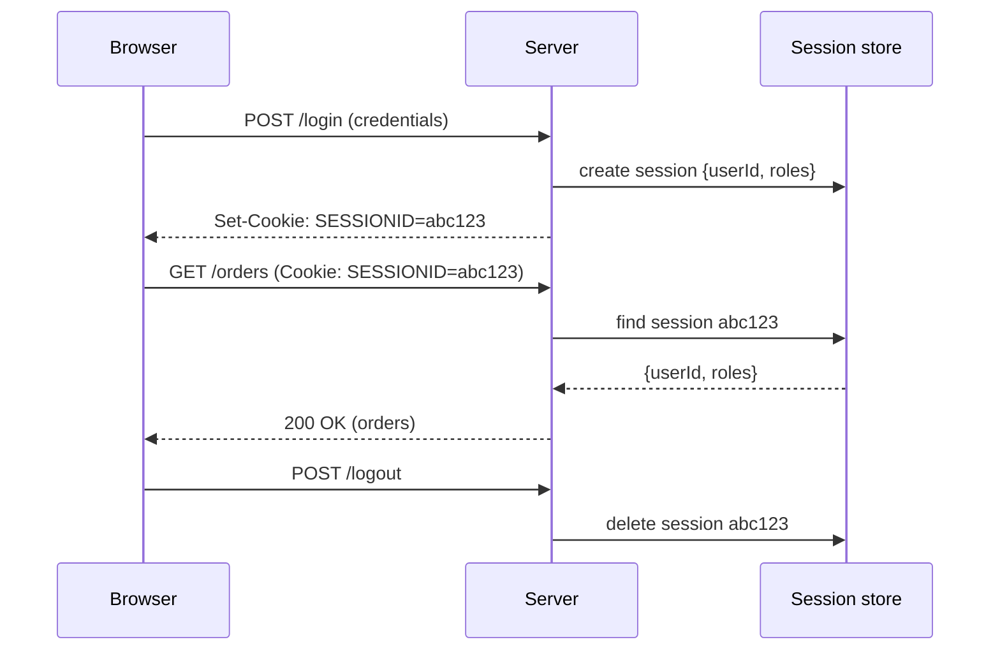
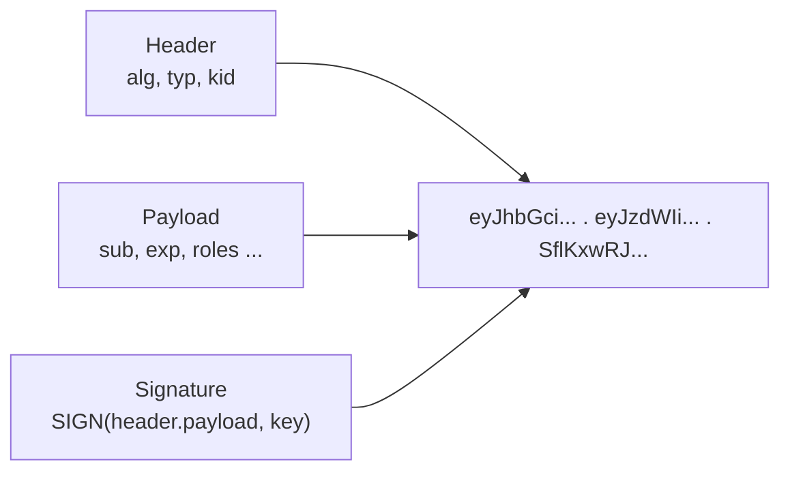
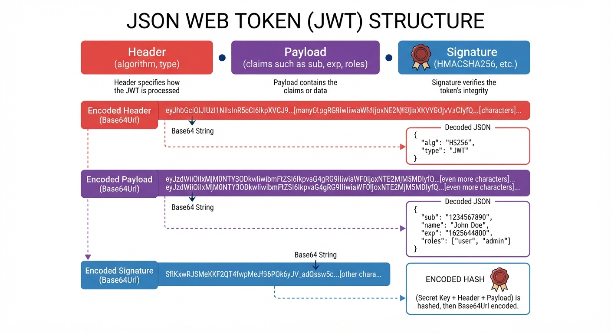
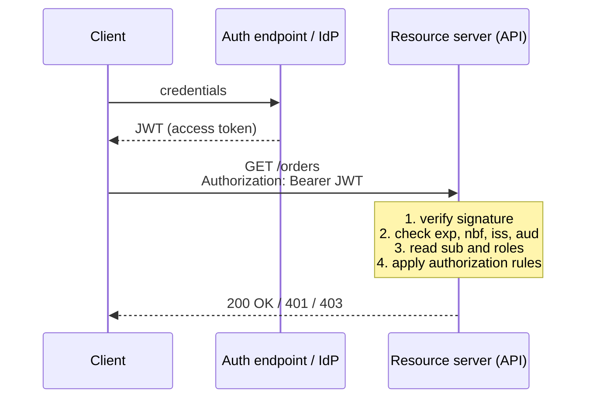
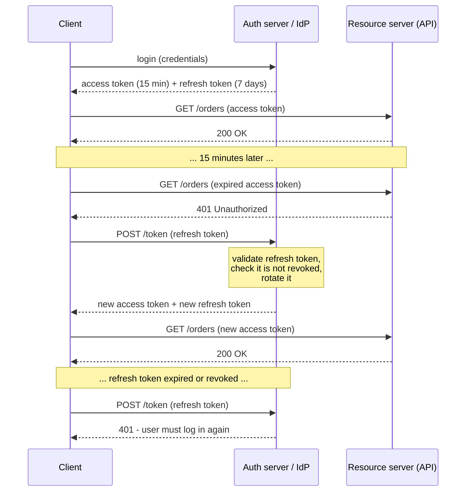
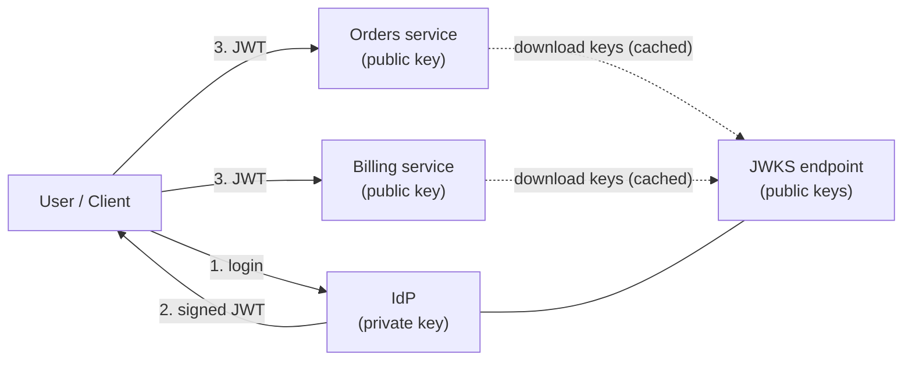

# Security - Authorization

## Authorization Basics

In the previous chapter ([Security - Authentication](security-authentication.md)) we dealt with proving who the user is. This chapter focuses on two closely related problems. The first is **authorization** (*AuthZ*): deciding whether an already identified user may perform a particular operation on a particular resource. The second is how the application **remembers the authenticated user** between requests, because HTTP is stateless and the server would otherwise ask for credentials with every request.

The two questions are often mixed together in practice, because the same artifact (a session identifier or a token) usually carries both the identity and the information needed for authorization decisions. Still, it is useful to keep them conceptually separate.

## Authorization Approaches

There are several well-known models for deciding who may do what. They differ in flexibility and in the effort needed to maintain them.

**Role-Based Access Control (RBAC)** assigns users to roles (`USER`, `MANAGER`, `ADMIN`) and permissions are attached to roles. It is simple, easy to understand and sufficient for most applications. Its weakness is "role explosion" when the rules become more detailed (for example `MANAGER_OF_PRAGUE_BRANCH`).

**Permission-based (scope-based) access** lets the user or token hold fine-grained permissions such as `invoice:read` or `invoice:write`. Roles then become only a convenient bundle of permissions. OAuth 2.0 *scopes* are an example.

**Attribute-Based Access Control (ABAC)** evaluates rules over attributes of the user, the resource and the context: "a doctor may read a record of a patient assigned to their department during working hours". It is very flexible, but harder to design, test and audit.

**Ownership checks** are often forgotten. A user with the role `USER` may read invoices, but only *their own*. This kind of rule depends on the data and must be checked in the business logic (for example `invoice.getOwnerId().equals(currentUserId)`). Missing ownership checks are the cause of a very common vulnerability called *Insecure Direct Object Reference* (IDOR) or *Broken Object Level Authorization*, which is at the top of the OWASP API Security list.

**Access-control lists (ACL)** attach permissions directly to individual objects ("Alice can edit document 42"). They are very precise, but they are expensive to maintain at scale.

In web applications, these decisions are enforced in layers: coarse rules on URLs in the security filter chain (for example `/admin/**` only for `ADMIN`), method-level checks in the service layer (`@PreAuthorize`), and finally data-level checks (ownership). The authorization decision must always be made **on the server**; hiding a button in the frontend is only a convenience, never a protection.

## Remembering the User: Session

The classical solution is a **server-side session**. After successful login, the server creates a session object in its memory (or in a shared store such as a database or Redis), generates a long random **session ID** and sends it to the browser in a cookie. The browser sends the cookie automatically with every following request, and the server uses it to look up the session and thus the user and their roles.



The main advantage is that the server is in full control. Logging out or banning a user is trivial: the session is deleted and it stops working immediately. The cookie contains no data, only an opaque identifier, and with the flags `HttpOnly`, `Secure` and `SameSite` it is well protected against theft by scripts. The approach is mature and supported out of the box by Spring Security.

The disadvantages are related to scalability and architecture. The server must **keep state**. With multiple instances behind a load balancer, you need either *sticky sessions* or a shared session store, which is another component that must be operated and which becomes a potential bottleneck. Sessions are also awkward for mobile clients and for communication between different domains and services, since cookies are tied to browsers and domains. Finally, because cookies are sent automatically, session-based applications are exposed to **CSRF** (see [Security - Other concepts](security-other-concepts.md)).

## JSON Web Token (JWT)

A **JSON Web Token** (RFC 7519, pronounced "jot") is a compact, URL-safe string that carries a set of **claims** (statements) about a subject and is **digitally signed** (or, less commonly, encrypted). The key idea is that, unlike a session ID, the token is **self-contained**: it contains the information itself, and the server can verify its authenticity without looking anywhere. This is why JWT became the dominant approach for REST APIs, single-page applications, mobile applications and microservices.

### Structure of a JWT

A JWT consists of three parts separated by dots, where each part is encoded by **Base64URL**:

```
xxxxx.yyyyy.zzzzz
header.payload.signature
```

The **header** describes the token itself, mainly the signing algorithm (`alg`) and token type, and often a key identifier (`kid`) that tells the receiver which key to use for verification:

```json
{ "alg": "RS256", "typ": "JWT", "kid": "key-2026-01" }
```

The **payload** contains the claims. The standard defines several *registered claims*: `iss` (issuer, who created the token), `sub` (subject, usually the user ID), `aud` (audience, for whom the token is intended), `exp` (expiration time), `nbf` (not valid before), `iat` (issued at) and `jti` (unique token ID). In addition, the application adds its own claims, for example roles or the e-mail:

```json
{
  "iss": "https://auth.example.com",
  "sub": "42",
  "aud": "orders-api",
  "iat": 1790000000,
  "exp": 1790000900,
  "roles": ["USER", "MANAGER"]
}
```

The **signature** is computed over the encoded header and payload using the algorithm and key chosen by the issuer:

```
signature = SIGN( base64url(header) + "." + base64url(payload), key )
```





The payload is only **encoded**, not encrypted. Anybody who obtains the token can read it (paste it into jwt.io and see). Never put passwords, personal data or other secrets into an ordinary signed JWT.


### Why Is JWT Secure?

The security of JWT does not come from hiding the content, but from **integrity**. Because the signature depends on the header, the payload and a key known only to the issuer, any modification of a single character of the token (for example changing `"roles": ["USER"]` to `["ADMIN"]` or extending `exp`) makes the signature invalid. A client or an attacker can read the token and cannot forge or modify it without the signing key. The receiver verifies the signature, checks the claims (`exp`, `iss`, `aud`) and only then trusts the content.

This security holds only if the implementation is careful. Typical pitfalls are accepting the algorithm `none` (an unsigned token), letting the attacker choose the algorithm in the header (for example confusing RS256 with HS256 and using the public key as the HMAC secret), not validating `exp`, `iss` or `aud`, using weak secrets in HMAC, and storing tokens in places accessible to attackers. Mature libraries (and Spring Security) protect against these issues by default, so the rule is again: do not parse and verify tokens manually.

### Advantages and Disadvantages

The most important advantage is **statelessness**. The server needs no session store, so the application scales horizontally without any shared state, and each instance can verify the token on its own. JWT also works well across domains and different kinds of clients (browser, mobile app, another service), because it is simply sent in a request. A single token can be accepted by many services, which suits microservices and SSO. The claims carried in the token (user ID, roles) save a database lookup for each request.

The disadvantages are equally important. A JWT **cannot be easily revoked**: once issued, it is valid until it expires, even if the user logged out, was banned or changed roles. Because of this, the lifetime of access tokens is kept short (minutes), and a *refresh token* is used to get new ones (see below). Revocation before expiry needs additional state (a blacklist of `jti`, or a version number checked against the database), which partly defeats the point of being stateless. Tokens are also larger than a session ID and are sent in every request. The data in the token can become **stale** (a role change takes effect only after the next token is issued). And finally, the client has to store the token somewhere, which creates its own security questions discussed later in this chapter.

There is one more, rather drastic way to revoke tokens: **changing the signing key**. Tokens signed with the old key no longer pass the signature check, so all of them become invalid at once. This is the standard reaction to a leaked or suspected-compromised key, and it is also how a "log out everybody" button can be implemented. The disadvantage is that it is not selective: every user is logged out (or forced to use the refresh token to obtain a new access token), and with a symmetric key all services that share the secret must be updated at the same time. With asymmetric keys and the `kid` header it is more comfortable, because the IdP can publish a new key, start signing with it, and later remove only the old key from the key set, so a planned **key rotation** is smooth and affects only tokens signed with the retired key. Selective revocation of a single token or a single user still requires the additional state mentioned above.

### How a JWT Is Created

The process happens on the issuer's side, usually right after a successful authentication:

1. The server verifies the user's credentials (see [Security - Authentication](security-authentication.md)).
2. It builds the payload: identity (`sub`), issuer, audience, issue time, expiration, and the application claims (roles).
3. It builds the header with the algorithm and the key identifier.
4. It encodes the header and the payload using Base64URL and concatenates them with a dot.
5. It computes the signature over this string using the signing key.
6. It concatenates all three parts and returns the token to the client.

A simplified example in Spring Boot using the Nimbus library, which is a part of Spring Security's OAuth2 support:

```java
@Service
public class TokenService {

    private final JwtEncoder encoder; // configured with the signing key

    public String createAccessToken(User user) {
        Instant now = Instant.now();
        JwtClaimsSet claims = JwtClaimsSet.builder()
            .issuer("https://auth.example.com")
            .subject(String.valueOf(user.getId()))
            .audience(List.of("orders-api"))
            .issuedAt(now)
            .expiresAt(now.plus(15, ChronoUnit.MINUTES))
            .claim("roles", user.getRoles())
            .build();

        return encoder.encode(JwtEncoderParameters.from(claims)).getTokenValue();
    }
}
```

The idea is simply "put claims in, get a signed string out". The chosen key and algorithm are hidden in the configuration of the `JwtEncoder`.

### How a User Is Authorized with a JWT

After login the client receives the token and then attaches it to every request. The server-side verification is purely computational:



The resource server extracts the token from the request, verifies the signature with the appropriate key, validates the standard claims, and creates the security context (the current user and their authorities) from the claims. Then the usual authorization rules are applied (roles, method security, ownership). If the token is missing, invalid or expired, the server responds with `401 Unauthorized`; if the token is valid but the user lacks the permission, the response is `403 Forbidden`.

With Spring Boot, almost everything is configuration:

```java
@Bean
SecurityFilterChain api(HttpSecurity http) throws Exception {
    http
        .authorizeHttpRequests(a -> a
            .requestMatchers("/admin/**").hasRole("ADMIN")
            .anyRequest().authenticated())
        .oauth2ResourceServer(o -> o.jwt(Customizer.withDefaults()));
    return http.build();
}
```

The key (or the URL from which the public key is downloaded) is configured in `application.properties`, for example `spring.security.oauth2.resourceserver.jwt.jwk-set-uri`. Then a controller can simply use `@PreAuthorize("hasRole('MANAGER')")` or take the current user as `@AuthenticationPrincipal Jwt jwt`.

### Access Token and Refresh Token

Because a JWT is hard to revoke, the usual design uses two tokens. The **access token** is a short-lived JWT (5-15 minutes) used for calling the API. The **refresh token** is long-lived (days or weeks), is used *only* to obtain a new access token from the issuer, and is therefore sent to just one endpoint. Refresh tokens are typically stored on the server (or at least tracked there), so that they can be revoked, and are often **rotated**: each use gives a new refresh token and invalidates the previous one, so a stolen token is detected when both the attacker and the user try to use it. This design combines the scalability of stateless access tokens with the controllability of server-side state at a low cost, because the server is contacted only every few minutes instead of with every request.

The following diagram shows the principle. The client works with the short-lived access token until the API rejects it as expired, and then it quietly obtains a new one using the refresh token, without bothering the user with a new login. The user has to log in again only when the refresh token itself expires or is revoked.



The right lifetimes are a compromise between security (the shorter, the smaller the window for misuse of a stolen token) and convenience (the longer, the fewer renewals and logins). The following values are typical starting points and should be adjusted to the risk of the application:

| Token | Typical lifetime | Notes |
| --- | --- | --- |
| Access token | 5-15 minutes (up to 1 hour for low-risk applications) | Sent with every request, so it should be short; it limits the damage of a theft because it cannot be easily revoked |
| Refresh token | Hours to days for sensitive applications (for example banking: minutes to hours of inactivity), 7-30 days for common web applications, longer for "remember me" or mobile apps | Sent only to the token endpoint; often has a sliding expiration (extended by activity) plus an absolute maximum, and is rotated on each use |
| ID token (OpenID Connect) | Minutes | Only proves the login to the client application, it is not used to call APIs |


Specific long-running tasks do not fit this model well. An export that runs for an hour, a file upload, a batch job or a link in an e-mail that must work for a day cannot depend on a 15-minute access token, and you should not make the access token long-lived for everybody just because of such exceptions. Instead, issue a dedicated **custom token** for that single purpose: a separate token with a narrow scope (for example only `report:download` for one specific report), its own audience, a lifetime matching the task, and preferably single use. If it leaks, the damage is limited to that one operation. Typical examples are signed download URLs, password-reset and e-mail verification tokens, and tokens for background jobs or service-to-service calls.


### Signing: Symmetric vs. Asymmetric Keys

The signature algorithm is the most important design decision for JWT.

**Symmetric signing (HMAC, for example HS256)** uses a single **shared secret** to both create and verify the signature. It is fast, simple, and produces short tokens. The drawback is that everyone who can verify a token can also **forge** one. All services therefore have to share the secret, and the compromise of any of them compromises the whole system. This variant fits a **single application** (or a small, fully trusted group of services) in which the same component issues and verifies the tokens, as in a typical monolith or a student project. The secret must be long and random (at least 256 bits) and kept out of the source code.

**Asymmetric signing (RSA or ECDSA, for example RS256, ES256)** uses a **key pair**. The issuer signs with the **private key**, which it never shares, and everybody else verifies with the **public key**, which can be published freely. A verifier can check a token but cannot create one. The cost is slightly slower operations (mainly signing with RSA), larger tokens and the need for key management. This variant fits **distributed systems, microservices, third-party consumers and any case where issuer and verifier are different parties**. EdDSA (Ed25519) is a modern alternative with small keys and fast operations, though support varies between libraries.

| | Symmetric (HS256) | Asymmetric (RS256 / ES256) |
| --- | --- | --- |
| Keys | One shared secret | Private key (issuer), public key (everyone) |
| Who can verify | Everyone who knows the secret | Everyone with the public key |
| Who can forge | Everyone who knows the secret | Only the issuer |
| Speed and size | Fast, small | Slower, larger |
| Typical use | Monolith, one trust domain | Microservices, IdP, third parties |
| Key rotation | Hard (all parties must change) | Easy with `kid` and published key set |

### Identity Provider Issues, Services Consume

The asymmetric approach enables an important architectural pattern. A dedicated **identity provider (IdP)**, such as Keycloak, Auth0, Microsoft Entra ID or your own authorization service, is the only component that authenticates users and holds the private key. All the other services (the "resource servers") are **only consumers** of the token. They need just the public key, which the IdP publishes at a well-known URL as a **JWKS** (JSON Web Key Set) endpoint. The `kid` header tells the consumer which key from the set to use, so keys can be rotated without redeploying services.



This brings several benefits. Credentials are handled in one place only, so the services never see passwords and do not need access to the user database. The services do not need to call the IdP for every request, which removes a bottleneck and a single point of failure at runtime. A compromise of a consumer does not allow the attacker to issue tokens. New services can be added just by configuring the IdP address, and the same login works across all of them (SSO). Services can also be written in different languages, because the JWT is a standard. It is also the principle on which OAuth 2.0 and OpenID Connect work: the IdP issues tokens and the APIs validate them.

## Storing the JWT on the Client and Sending It to the Server

Once the browser receives a token, it must keep it somewhere and send it with later requests. The choice is a trade-off between the two most common web attacks, XSS and CSRF (both are described in [Security - Other concepts](security-other-concepts.md)).

### Local Storage / Session Storage and the Authorization Header

The application saves the token with JavaScript (`localStorage` survives browser restarts, `sessionStorage` lives until the tab is closed) and attaches it manually to every request:

```
Authorization: Bearer eyJhbGciOi...
```

The advantages are simplicity, full control, no automatic sending (so the approach is **not vulnerable to CSRF**) and independence of domains, which makes it handy for SPAs and for APIs consumed by multiple clients. The main disadvantage is that any JavaScript running on the page can read the storage, so a single **XSS** vulnerability (or a compromised third-party script) allows an attacker to steal the token and use it from anywhere until it expires. The token is also not available to the server on the initial page load, and the developer must write the code that attaches it.

### Cookie (HttpOnly, Secure, SameSite)

The server sends the token in a `Set-Cookie` header with protective flags and the browser sends it back automatically:

```
Set-Cookie: access_token=eyJ...; HttpOnly; Secure; SameSite=Strict; Path=/api
```

`HttpOnly` makes the cookie invisible to JavaScript, so XSS cannot read it. `Secure` means that it is sent only over HTTPS. `SameSite` restricts the cookie from being attached to cross-site requests, which is the main defence against CSRF. The advantages are therefore a strong protection against token theft and a transparent usage with no client code. The disadvantages: cookies are sent automatically, so CSRF protection must be considered (`SameSite`, CSRF tokens); they work well only when the frontend and the API share a site (or when CORS with credentials is correctly configured, see [Security - Other concepts](security-other-concepts.md)); they are less natural for mobile applications and third-party API clients; and cookies have a size limit of about 4 KB, which is a problem with big tokens. Note that XSS can still *use* the cookie by making requests from the victim's browser, although it cannot read it.

### In-Memory Storage

The token is kept only in a JavaScript variable (for example in the state of the application) and is never written to persistent storage. It is the safest against persistent theft, because the token disappears on page reload, and it is not vulnerable to CSRF. But it is still readable by a running malicious script, and the user would have to log in again after every refresh. In practice, it is combined with a **refresh token in an HttpOnly cookie**: after a reload the application silently asks the server for a new access token using the cookie, and keeps it in memory afterwards.

### Comparison

| Storage | Readable by XSS | CSRF risk | Convenience | Note |
| --- | --- | --- | --- | --- |
| Local / session storage + `Authorization` header | Yes | No | High | Simple, widely used for SPAs |
| `HttpOnly` cookie | No (but can be used) | Yes, needs `SameSite` / CSRF token | High | Best for same-site browser apps |
| In memory + refresh token in `HttpOnly` cookie | Access token only while the page runs | Limited (refresh endpoint only) | Medium | Common recommended compromise |

There is no universally perfect option. For browser applications, the commonly recommended approach is a short-lived access token held in memory and a refresh token in a protected cookie; for a simple student project, an `HttpOnly` cookie with `SameSite` or the `Authorization` header with a strict XSS defence are both acceptable. Regardless of storage, always use HTTPS, keep token lifetimes short, never put sensitive data into the payload, and validate every token on the server.
